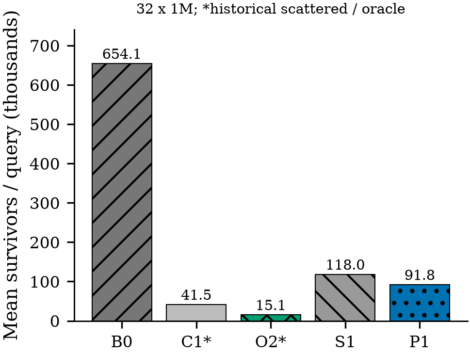
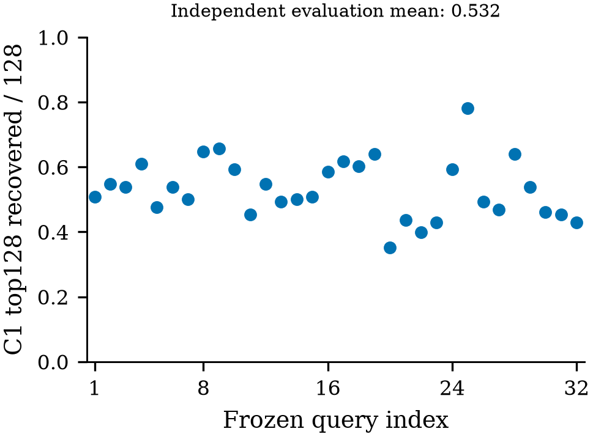
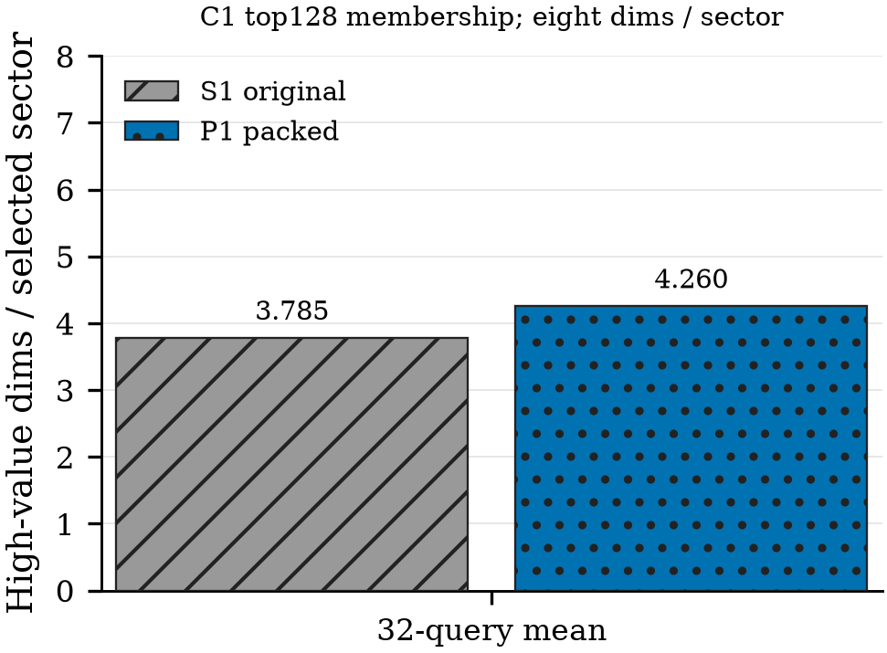
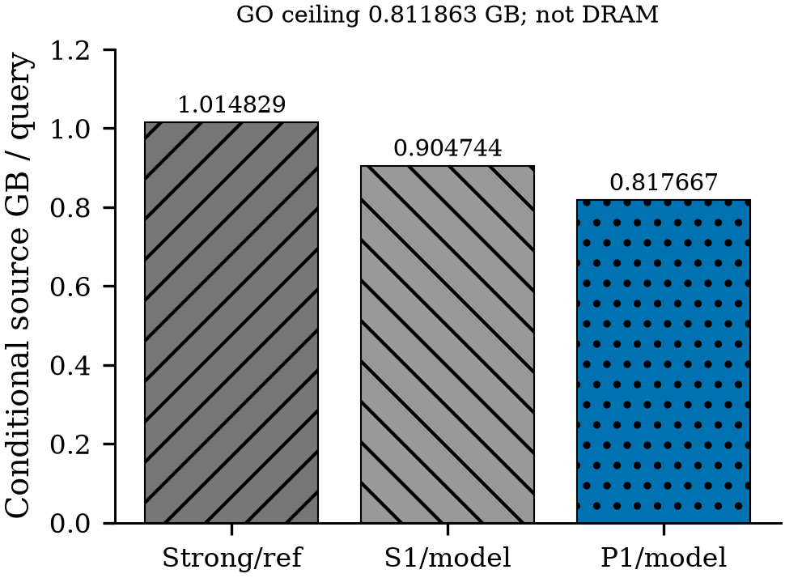

# Gate7: certificate-aware sector packing

**CONDITIONAL_PACKING — stop; no GPU Gate8.** One global PACK8 permutation
reduces average survivors by **22.171636%** against original-layout S1, below the
30% requirement. The p90 query ratio is **1.215007**, above the <=0.80 GO target.
The conditional source-byte model is **817,666,504 B/query**, only
**19.428132%** below the strong progressive reference, below the 20% requirement.
This is a CPU information diagnostic, **not an end-to-end speedup**.

## Frozen comparison

GIST1M: **1,000,000 row occurrences x 960 original FP32 coordinates**.
Range search uses the same 32 evaluation queries, cutoff and original-order
FP64 oracle. Training has 1024 deterministic unique queries disjoint from all 32.
Only existing C1 moments/scores, one co-selection matrix and one fixed greedy
packing were used; no labels, query-object outcomes, variants or sweeps.

| Method | Mean survivors/query | Provenance and eligibility |
|---|---:|---|
| B0 original first16 sectors | 654,128.18750 | Historical parent; nominal512B |
| C1 scattered top128 | 41,480.06250 | Historical information reference, not sector-eligible |
| O2 original pair sector oracle | 15,125.25000 | Historical oracle; per-pair selection/full reads unpriced |
| S1 original sector moment | 118,012.12500 | Historical primary comparator; nominal512B |
| P1 packed sector moment | 91,846.90625 | New32M-pair CPU certificate; nominal512B |

B0/C1/O2/S1 are immutable parent results, not remeasured timing comparators.
P1 improved 21 queries, tied 3, and worsened 8. Its selection recovers 53.247070%
of evaluation C1 top128 demand (training 57.125092%); selected-sector purity
increases from 3.785156 to 4.259766 high-value coordinates per eight-coordinate
sector. This is partial holdout generalization, not robust per-query dominance.

## Quality and limitations

- All 32M packed full scores match the frozen original scores **bit-for-bit**;
  all 32M P1 partials have **zero false rejections and zero unsafe bounds**.
- All 960M transformed FP32 coordinate bit patterns are restored exactly.
  The candidate uses one packed database; the original remains external,
  read-only validation material, closed before candidate calls.
- Native fixtures include an FP64 order-sensitivity counterexample. Both full
  and subset additions keep original dimension order through the permutation.
- The model512M + 3328*survivors assumes selected FP32 values are retained without
  rereads. Mapping, original-order restoration, retention, recomputation and
  spill costs are **UNKNOWN**, not zero. Actual DRAM/sectors and latency are
  **NOT_MEASURED**; a full fallback is **NOT_IMPLEMENTED**.
- Gate -1 admits bounded testing only. Generic affinity packing is prior art;
  no paper novelty claim follows. See[the eight-area audit](prior_art/PRIOR_ART_PACKING.md)
  and[the citation locator note](prior_art/CITATION_NOTE.md).
- CPU training 1, population 1; GPU/NCU/NSYS starts **0**. Keeper and manuscript
  unchanged. Closure-only observer repairs are retained, not hidden retries.

## Four diagnostics

Vector PDF/SVG counterparts and 300DPI PNGs are included. Complete fixed-pool
counts have no invented timing confidence intervals.

[Decision and five required answers](DECISION.md) · [Reproduction](REPRODUCE.md) ·
[Validation](VALIDATION.md) · [Claim-evidence ledger](CLAIM_EVIDENCE.md) ·
[Numerical boundary](NUMERICS.md) · [Untested update property](UPDATE_PROPERTY.md)
