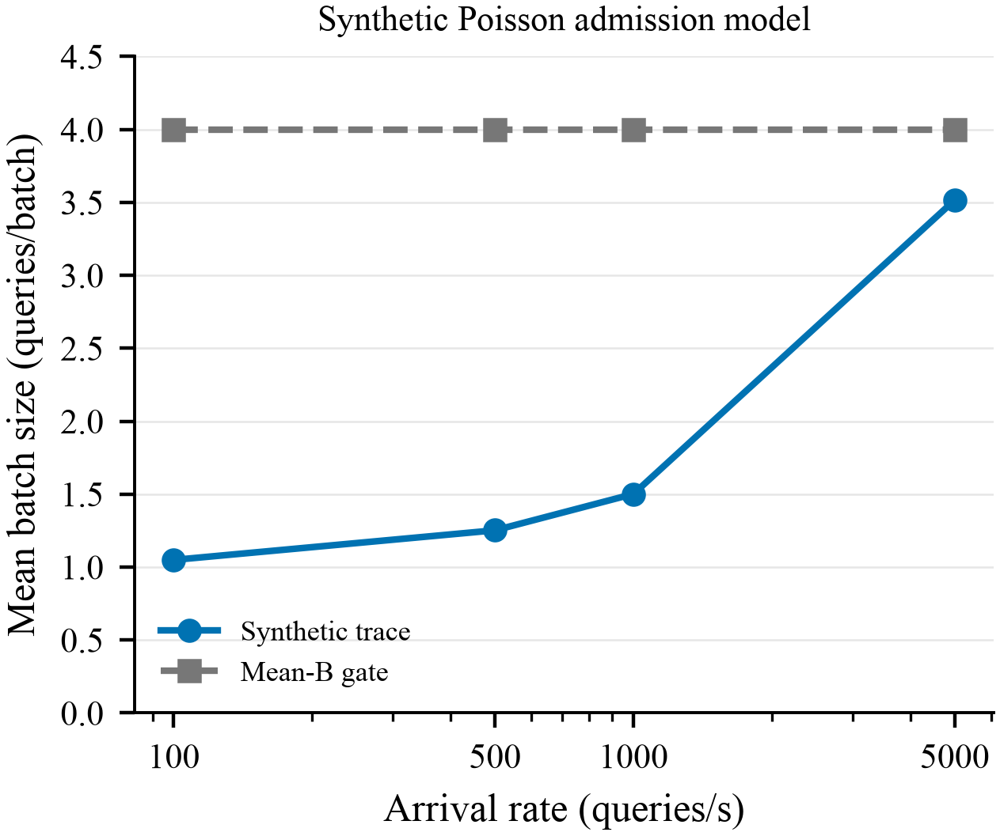
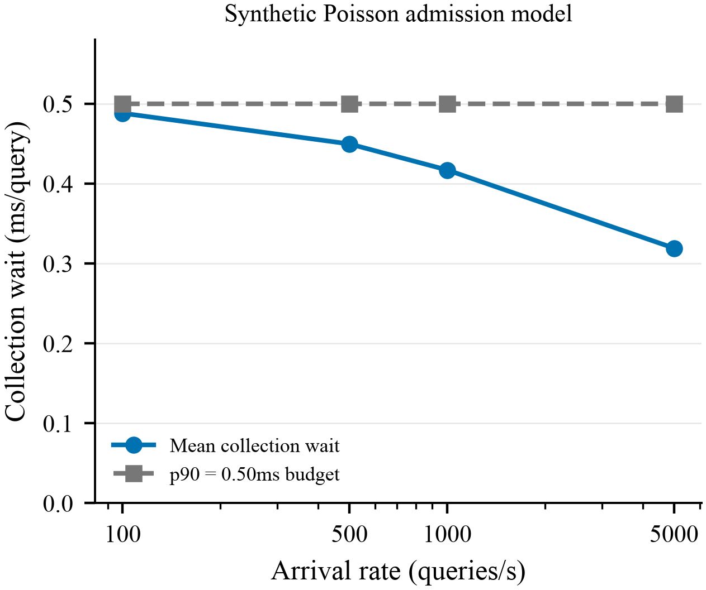
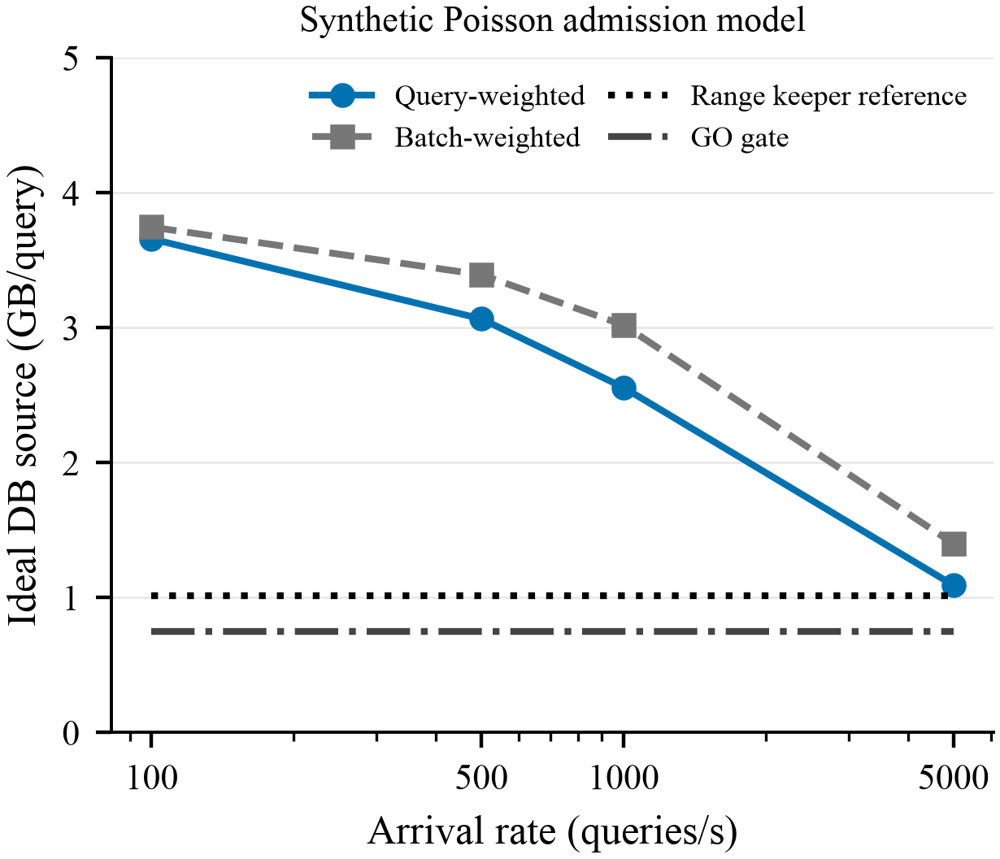

# Cross-query database reuse: Gate0

**Decision: NO_GO_CROSS_QUERY_REUSE for the frozen Poisson/window-or-cap model.**
Even the highest specified rate misses the source-byte gate before query state,
output, selection, control or updates are priced. This is a synthetic admission
falsification, not a GPU performance result or a universal rejection of batching.

| Arrival rate (queries/s) | Mean B (queries/batch) | Ideal source GB/query, query-weighted | Batch-weighted E[3.84/B], GB | p90 collection wait (ms) |
|---:|---:|---:|---:|---:|
|100|1.049362|3.659366|3.746827|0.500000|
|500|1.252285|3.066394|3.393601|0.500000|
|1000|1.501141|2.558054|3.020859|0.500000|
|5000|3.515680|1.092250|1.400618|0.500000|

The frozen progressive reference is **1.014828776 GB/query**, from the earlier
fixed32 exact-range source model. At5000qps the new optimistic source model is
**1.076289543x** that reference, not a saving. This is not a same-contract mixed
range/kNN comparison: progressive kNN bytes and mixed-workload latency are unknown.

## What was executed

One CPU model process, four independently seeded synthetic traces of100,000
queries each, exact50/50 range/kNN tags, maximum8 queries and500us collection.
No warmup, drops, deliberate backlog or rate/window/cap sweep. A1ps timestamp
grid makes timer ties explicit; the final partial batch drains normally. The
model assumes an immediately available executor and does not model GPU service.
All400,000 raw rows were independently checked for ownership, cap, timeout,
dispatch, mix and cost reconstruction. Actual distances were never evaluated.

The continuous-Poisson oracle is B=min(1+Poisson(lambda/2000),8). Thus long-run
mean B<=1+lambda/2000, and at1000qps it is about1.5, not the plan's illustrative
4.3. At5000qps its mean is3.494258588; the finite trace's3.515680 is sampling
variation, not a violation of a samplewise upper bound. The exact uncapped
long-run byte lower bound at5000qps is3840000000/3.5=1.097142857GB/query; cap8
cannot improve that mean. This proof is scoped to the frozen scheduler, not all
online schedulers or bursty arrival processes.

## Admission and claim boundary

Prior-art admission stays **NOT_ADMITTED**. Ordinary batching, tile reuse and
timeout/cap scheduling already exist. No inspected source establishes the
entire proposed strict SLA/mixed-exact/update evaluation, so direct subsumption
is NOT_ESTABLISHED, not presumed. The user authorized only this bounded CPU
falsification; it is not a novelty pass. See [prior art](PRIOR_ART.md).

Redundancy -> mechanism -> module -> effect -> end-to-end benefit:
repeated DB reads -> cross-query co-execution -> window-or-cap admission ->
too little natural batching at the frozen rates -> **E2E benefit NOT_RUN**.
Exact search FN/FP, actual DRAM, total p99 SLA and update ACK remain unknown.
Production keeper, CUDA sources and manuscript are unchanged. GPU Gate1 is
not admitted; neither a longer wait nor a larger batch was tested to rescue it.

## Evidence and reproduction

- [Frozen contract](CONTRACT.json), [decision and five questions](DECISION.md),
  [claim ledger](CLAIM_EVIDENCE.md), [validation](VALIDATION.md)
- [Batch distributions](workload/BATCH_DISTRIBUTIONS.json),
  [queueing](workload/QUEUEING.json), [shared-source costs](cost/SHARED_DB_BYTES.json)
- [Snapshot design and ordering caveats](semantics/SNAPSHOT_MODEL.md)
- [Reproduction](REPRODUCE.md); full traces are retained outside Git with hashes.

Figures are synthetic-model points, one trace/rate, with no invented confidence
bands. Vector PDF/SVG,400dpi PNG and exact CSVs accompany them.
