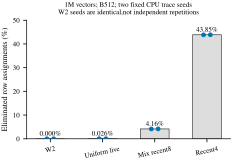
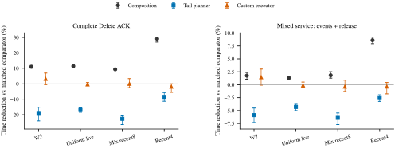
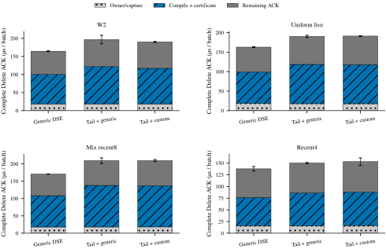

# Dependency-aware GPU update transformation: decision package

**Decision: B — ENGINEERING_STRONG; no distinct Tail algorithm admitted.**
The strict state-preserving composition opportunity is real, but generic copy
propagation generates the identical final assignment set. On the same Thrust
executor, the tested Tail planner is slower in every fixed mixed-service trace.
The defensible win is coarse GPU execution plus generic composition, not a
unique Tail-Provenance state transformation.

## Mechanism chain: redundancy → mechanism → module → role → end-to-end benefit

| Redundancy / proposed cost | Mechanism | Module | Role | Same-contract complete-service evidence |
|---|---|---|---|---|
| Per-row control/execution repetition | Coarse standard-library indexed copy | `candidate.cuh::generic_rows` | Execute original legal wave rows without hundreds of thousands of tiny DMA activities | W2 WAVES→GENERIC_WAVES: 63.51% reduction; no assignment elimination |
| Overwritten row assignments and dependency waves | Generic original-source propagation + nonalias certificate | `generic.hpp`, `candidate.cuh` | Emit one independent final plan while preserving retired bytes | Recent4 GENERIC_WAVES→GENERIC_DSE: 8.61% service / 29.09% Delete ACK reduction; coupled bundle, not pure bytes |
| Proposed Tail-specific ownership advantage | Descending-tail provenance specialization | Frozen parent `plan.hpp` | Alternative planner for exactly the same final assignments | Tail+Thrust regresses service 2.58%–6.40% versus generic DSE+Thrust |
| Proposed executor overhead | Custom CTA-per-row materializer | `candidate.cuh::materialize_final` | Execute the same Tail final plan | No confirmed full-service gain; all four intervals cross parity |

## 1. Strong comparator first

These are paired geometric **candidate/comparator** time changes. Positive is
slower. Tail uses the **same final assignments and exact Thrust functor** as
generic DSE; the changed component is the CPU planner.

| Fixed trace | Tail/generic DSE: service time change, 95% CI | Tail/generic DSE: Delete ACK time change, 95% CI |
|---|---|---|
| W2_ORIGINAL | +5.88% [+4.50, +7.32] | +19.39% [+15.15, +24.02] |
| UNIFORM_LIVE | +4.30% [+3.78, +5.00] | +16.89% [+15.64, +18.37] |
| MIX_RECENT8 | +6.40% [+5.46, +7.72] | +22.67% [+20.75, +26.42] |
| RECENT4 | +2.58% [+1.95, +3.23] | +9.01% [+5.65, +11.29] |

All four service regressions have 95% intervals above zero and 0/6 process wins.
This is concrete same-contract counterevidence, not rejection based solely on
similarity to a broad prior-art family. The custom executor does not establish a
service win over Tail+Thrust: all four corresponding intervals cross zero.

## 2. Same-campaign engineering result

Service = formal events + explicit release, in milliseconds. Each entry is the
median of six independent complete process totals; **do not sum component medians**.
The machine has the replaced CPU; historical old-CPU timings are not controls.

| Fixed trace | NATIVE | WAVES | GENERIC_WAVES | GENERIC_DSE | TAIL_GENERIC | TAIL_CUSTOM |
|---|---|---|---|---|---|---|
| W2_ORIGINAL | 1612.190 | 1610.713 | 586.911 | 577.847 | 604.707 | 603.801 |
| UNIFORM_LIVE | 1596.881 | 1614.391 | 591.410 | 582.917 | 606.055 | 608.264 |
| MIX_RECENT8 | 1597.005 | 1615.558 | 600.220 | 590.121 | 624.433 | 630.498 |
| RECENT4 | 1586.670 | 1606.797 | 606.026 | 553.257 | 568.173 | 566.936 |

| Fixed trace | Generic DSE / Native paired speedup | Service time reduction, 95% CI | Process wins |
|---|---|---|---|
| W2_ORIGINAL | 2.788x | 64.13% [63.96, 64.32] | 6/6 |
| UNIFORM_LIVE | 2.747x | 63.60% [63.30, 64.00] | 6/6 |
| MIX_RECENT8 | 2.736x | 63.45% [62.76, 64.45] | 6/6 |
| RECENT4 | 2.874x | 65.20% [64.88, 65.47] | 6/6 |

All methods preserve allocated-state bytes, occurrence maps, append semantics,
query authority and complete outputs. This is not a weaker tombstone/indirection
contract. It is also not a comparison against Faiss, CAGRA or the original GTS
tree: all methods use the same frozen PDX-style exact-range backend.

Mean complete Delete ACK, in microseconds per batch (median across processes):

| Fixed trace | NATIVE | WAVES | GENERIC_WAVES | GENERIC_DSE | TAIL_GENERIC | TAIL_CUSTOM |
|---|---|---|---|---|---|---|
| W2_ORIGINAL | 1222.99 | 1231.71 | 184.10 | 164.37 | 189.73 | 190.01 |
| UNIFORM_LIVE | 1206.17 | 1229.10 | 183.44 | 162.74 | 188.97 | 191.11 |
| MIX_RECENT8 | 1201.22 | 1229.89 | 188.37 | 170.69 | 206.58 | 208.36 |
| RECENT4 | 1193.98 | 1217.54 | 194.19 | 135.87 | 149.74 | 150.01 |

## 3. What redundancy actually exists

GIST1M: **1,000,000 x 960 FP32 coordinates = 3.84 GB**, plus the 12-byte input
header. Each main process performs **500,000 replacement pairs = 1,000,000
point updates**, keeps 1M live vectors, and issues **160 formal exact range
queries** at five visible boundaries. Eight warmup queries are excluded.
Update batch limit is 512; the query batch is one. Query radius is
0.705625057220459. The 32 query IDs are frozen and reused, not 10k distinct queries.

Performance uses fixed seed 2026101701:

| Fixed performance trace | Native moves | Final assignments | Eliminated | RAW edges | Fresh occurrences deleted later | Distinct original occurrences deleted |
|---|---|---|---|---|---|---|
| W2_ORIGINAL | 500,000 | 500,000 | 0.0000% | 0 | 0 | 500,000 |
| UNIFORM_LIVE | 500,000 | 499,869 | 0.0262% | 145 | 106,972 | 393,028 |
| MIX_RECENT8 | 499,907 | 479,197 | 4.1428% | 21,590 | 277,846 | 222,154 |
| RECENT4 | 497,898 | 279,631 | 43.8377% | 355,434 | 498,863 | 1,137 |

Uniform-live deletes 106,972 previously inserted occurrences but eliminates only
131 assignments. Therefore high churn or fresh-object re-deletion does **not**
by itself imply within-batch physical dependence. Recent4 is a synthetic
logical-age cancellation stress, not a production trace; it removes only 1,137
of the initial million occurrences despite 500k replacement operations.
Calling every family “50% distinct objects replaced” would be false.

Two fixed CPU structure seeds and both N=4096/N=1M are retained in
[tables/structure.csv](tables/structure.csv). For 1M Recent4, elimination is
43.84% / 43.86%; the two-seed figure average is 43.85%. W2 seeds are identical,
not independent workload realizations. Timing uses one seed per family.
“Final assignments” is an opaque-entry-row provenance-copy count, **not** an
unrestricted data-movement lower bound allowing compression or indirection.

*Two fixed CPU traces per family; dots are separate seeds, not a confidence
interval. All bars start at zero. The workload selector never inspects the
physical assignment plan.*

## 4. Composition pays only for a nonexclusive bundle

Same standard-library indexed-copy executor, original dependency waves versus
generic final-plan composition:

| Fixed trace | Generic DSE / generic waves: service reduction, 95% CI | Delete ACK reduction, 95% CI |
|---|---|---|
| W2_ORIGINAL | 1.75% [1.07, 2.38] | 10.98% [10.11, 11.82] |
| UNIFORM_LIVE | 1.34% [1.06, 1.63] | 11.40% [10.75, 11.98] |
| MIX_RECENT8 | 1.82% [1.27, 2.52] | 9.33% [9.09, 9.53] |
| RECENT4 | 8.61% [7.95, 9.22] | 29.09% [26.97, 30.21] |

Recent4 supports an 8.61% complete-service reduction and 29.09% complete Delete
ACK reduction for the **generic composed implementation**. This contrast changes
assignment count, wave launches and CPU planning together; it does not isolate a
pure DRAM-byte effect. W2 has zero assignment elimination but still improves:
its gain is evidence for simpler organization/planning, not saved row payload.
Different families also have different live contents and query costs; the four
points are not a controlled causal law of elimination rate versus speedup.

*Six process pairs; fixed-seed 20,000-resample bootstrap, pointwise 95% intervals.
Composition = DSE/waves with the same Thrust functor; Tail planner = Tail/DSE
with identical final plans; custom executor = custom/Thrust with the same Tail
plan. Positive reduction is faster. No multiple-comparison adjustment or
cross-workload confidence claim is made.*

## 5. Operator-level physical evidence

NSYS has independently matched every delete/insert scope to the validated
execution ledger. The table contains **delete scopes only**, not query or insert
traffic. Logical payload is destination-write request bytes, not read+write DRAM.

| Trace | Variant | Copy APIs | Memcpy activities | Kernels | D2D activity bytes | H2D metadata bytes | Logical destination-write bytes |
|---|---|---|---|---|---|---|---|
| W2_ORIGINAL | NATIVE | 500,000 | 500,000 | 0 | 1,920,000,000 | 0 | 1,920,000,000 |
| W2_ORIGINAL | WAVES | 977 | 500,000 | 0 | 1,920,000,000 | 0 | 1,920,000,000 |
| W2_ORIGINAL | GENERIC_WAVES | 977 | 977 | 977 | 0 | 4,000,000 | 1,920,000,000 |
| W2_ORIGINAL | GENERIC_DSE | 977 | 977 | 977 | 0 | 4,000,000 | 1,920,000,000 |
| W2_ORIGINAL | TAIL_GENERIC | 977 | 977 | 977 | 0 | 4,000,000 | 1,920,000,000 |
| W2_ORIGINAL | TAIL_CUSTOM | 977 | 977 | 977 | 0 | 4,000,000 | 1,920,000,000 |
| RECENT4 | NATIVE | 497,898 | 497,898 | 0 | 1,911,928,320 | 0 | 1,911,928,320 |
| RECENT4 | WAVES | 10,497 | 497,898 | 0 | 1,911,928,320 | 0 | 1,911,928,320 |
| RECENT4 | GENERIC_WAVES | 977 | 977 | 10,497 | 0 | 3,983,184 | 1,911,928,320 |
| RECENT4 | GENERIC_DSE | 977 | 977 | 977 | 0 | 2,237,048 | 1,073,783,040 |
| RECENT4 | TAIL_GENERIC | 977 | 977 | 977 | 0 | 2,237,048 | 1,073,783,040 |
| RECENT4 | TAIL_CUSTOM | 977 | 977 | 977 | 0 | 2,237,048 | 1,073,783,040 |

W2 copy batching reduces Host calls from 500,000 to 977 but retains 500,000 GPU
memcpy activities. Its complete-service ratio is 1.000415, CI
[0.993988, 1.006574]: no established win. Coarse Thrust execution changes those
activities into 977 kernels plus metadata copies without eliminating any W2
row assignment. In Recent4, composition also collapses 10,497 dependent wave
kernels into 977 final-plan kernels and lowers logical destination writes from
1,911,928,320 to 1,073,783,040 bytes. Tail and generic DSE have the same payload.
Zero D2D memcpy-activity bytes for a kernel path **does not mean zero data copying**.

NSYS reports profiled NVTX function scopes, not primary Host-return ACKs; its
exclusive Host wall spans are not active CPU cycles. Device intervals are
**overlaid**, not added to Host partitions. NCU's eight captures contain the
first matching update kernel only. Generic-waves captures its first dependency
wave, whereas composed variants capture their first final plan; those are not
matched complete-batch scopes. L2 sector counts are retained per selected
launch. Both DRAM metrics are unavailable (`null`/`UNKNOWN`), not zero.
**Whole-service DRAM/L2 traffic remains UNKNOWN.** No extra GPU attempts were
used to fill those missing counters.

## 6. Planning and residual costs

This table deliberately uses the arithmetic mean of six process means to make
its stacked parts additive, unlike the primary median estimator. All units are
microseconds per batch. The remainder includes metadata, dispatch, execution,
wait, destructors and other ACK costs; it is **not GPU-only time**.

| Trace | Variant | Capture (us) | Construction/certificate (us) | Remaining ACK (us) | Whole ACK (us) |
|---|---|---|---|---|---|
| W2_ORIGINAL | GENERIC_DSE | 18.393 | 81.957 | 64.096 | 164.445 |
| W2_ORIGINAL | TAIL_GENERIC | 18.473 | 103.261 | 74.883 | 196.617 |
| W2_ORIGINAL | TAIL_CUSTOM | 17.996 | 99.137 | 72.926 | 190.060 |
| RECENT4 | GENERIC_DSE | 16.140 | 60.349 | 61.326 | 137.814 |
| RECENT4 | TAIL_GENERIC | 16.052 | 70.022 | 64.080 | 150.154 |
| RECENT4 | TAIL_CUSTOM | 16.455 | 71.424 | 65.281 | 153.161 |

*Arithmetic mean over six processes; error bars are total-ACK sample SD. Local
plan/set/vector destructors are outside the construction subtimer but inside
whole ACK. Native/fallback zero subtimer fields are uninstrumented sentinels,
not evidence of zero ownership work.*

For W2, process CPU event time (user+system) falls from 1601.555 ms with Native
to 568.455 ms with generic DSE. This is reduced consumed process CPU time, not a
claim of reduced machine-wide CPU utilization; average event core-equivalents
remain close to one. In generic DSE, W2 insert/query component medians are
260.409/136.830 ms versus 160.592 ms for delete. These component medians explain
remaining costs but are **not summed to reconstruct service**. Ownership and
wait costs have not disappeared.

Explicit update device workspace is 4096 bytes for the standard-library/custom
paths. Full process RSS includes inputs, answers and the common offline oracle;
isolated peak Host planner scratch is **UNKNOWN**. Known device-owned and
observed device usage are distinct columns in
[tables/service_and_resources.csv](tables/service_and_resources.csv).
Standalone maintenance is zero; no hidden statistics rebuild is performed.

## 7. Batch/operator coverage and regressions

Micro workload: the same 1M-vector initial input, 8,192 replacement pairs, batch
limits 1/32/512. Numbers are medians of six process means; the last column is the
median of process-level Delete p95 values, not a pooled p95.

| Batch limit | Variant | Mean Delete ACK (us) | Mean Insert ACK (us) | Mean outer replacement ACK (us) | Delete p95 (us) |
|---|---|---|---|---|---|
| 1 | NATIVE | 7.532 | 5.974 | 13.610 | 8.209 |
| 1 | WAVES | 7.492 | 5.994 | 13.593 | 8.148 |
| 1 | GENERIC_WAVES | 7.485 | 5.958 | 13.540 | 8.157 |
| 1 | GENERIC_DSE | 7.539 | 6.004 | 13.655 | 8.170 |
| 1 | TAIL_GENERIC | 7.530 | 5.962 | 13.576 | 8.163 |
| 1 | TAIL_CUSTOM | 7.514 | 6.020 | 13.642 | 8.267 |
| 32 | NATIVE | 82.858 | 20.330 | 103.619 | 90.007 |
| 32 | WAVES | 82.624 | 20.220 | 102.847 | 89.530 |
| 32 | GENERIC_WAVES | 17.857 | 19.918 | 37.911 | 19.619 |
| 32 | GENERIC_DSE | 17.229 | 19.859 | 37.106 | 19.351 |
| 32 | TAIL_GENERIC | 19.450 | 20.075 | 39.555 | 21.227 |
| 32 | TAIL_CUSTOM | 20.184 | 20.196 | 41.202 | 23.014 |
| 512 | NATIVE | 1265.875 | 193.907 | 1458.731 | 1361.990 |
| 512 | WAVES | 1263.146 | 193.174 | 1456.714 | 1348.137 |
| 512 | GENERIC_WAVES | 190.166 | 193.300 | 383.109 | 201.968 |
| 512 | GENERIC_DSE | 167.474 | 193.984 | 361.838 | 181.624 |
| 512 | TAIL_GENERIC | 197.051 | 196.897 | 393.870 | 212.561 |
| 512 | TAIL_CUSTOM | 198.740 | 197.225 | 397.947 | 214.684 |

B1 shares the same native fallback in every method. B32/B512 preserve Tail
planning regressions. All Insert, Query, Delete and outer Replacement means,
p50/p95, throughput and amortized time appear in
[tables/operators.csv](tables/operators.csv). Replacement p50 is derived from
all 252 raw pair CSVs, each checked against the closed raw SHA/size manifest;
it does not change the frozen paired estimator. Replacement throughput and
amortized time use replacement pairs (two point updates each); Delete/Insert
use points and Query uses queries. All 420 paired metric rows,
including regressions, order splits and marginal ratios, are in
[tables/contrasts.csv](tables/contrasts.csv).

## 8. Correctness, identity and custody

- **368/368 admitted target starts**, no failure, retry or additional GPU target:
  96 qualification, 252 primary, 20 profiler. All 24 sanitizer targets pass.
- Six variants each pass 400 exact query checks and 36 arbitrary-bit full-capacity
  delete cases, including retired rows, plus six invalid-batch rejections.
  NaN payloads are injected only to test byte copying after a finite build;
  they are not admitted search inputs. Stream slots and pointer churn are
  correctness tests, not concurrent-service claims.
- All 338 GIST targets are independently rechecked for complete inclusive member
  IDs, native squared bits and the unchanged distance-field tolerance, all mutation witnesses, final maps,
  frozen means and complete allocated capacity. Diagnostic qualification also
  checks changed destinations after each ACK and internal ordered-FP64 hit bits.
- Python/C++ each pass 125,664 exhaustive N<=8 sequences and 576 random deletes;
  Python also tests 1,000 arbitrary copy programs with an entry snapshot. Every
  batch of the 16 registered traces has identical generic/Tail final plans.
- Fresh binaries preserve all five selected query-function SASS hashes. Static
  compilation/resources, runtime correctness, sanitizers, profiling and primary
  timings remain distinct gates.
- The schema2 closure rejects extra physical jobs/files, verifies all guard
  devices against the registered pre-target GPU UUID, and seals source, binary,
  command, raw output and input identities. Linked libraries/CCCL headers have
  live pre-target hashes and post-target content/ctime/resolution checks;
  per-process `/proc` mappings and all dynamically loaded plugins are not claimed.
- Analysis and timelines are independently reconstructed, byte-identical and
  sealed to their analyzers and CLOSED identity before curation. New checker
  v3 and earlier helper versions are separately preserved; no measured code or
  raw output was overwritten. Auxiliary guard files were sealed post-campaign,
  not falsely described as pinned at target completion.
- A persistent private raw archive contains **10,583 members / 9,699,418,722
  uncompressed bytes**. Every member's size/SHA was reverified. The archive is
  3,390,917,106 bytes with SHA
  `a9931bc6ffa78c55c080246dda6abb96923662c9f2aa40e3085a58a494beba97`.
  Public manifests establish identity, **not public availability** of the raw
  archive. Large vectors and private host registrations are not uploaded.

See [evidence/EXECUTION.json](evidence/EXECUTION.json),
[evidence/QUALITY.json](evidence/QUALITY.json),
[evidence/CLOSED_BINDING.json](evidence/CLOSED_BINDING.json),
[evidence/DERIVED_BINDING.json](evidence/DERIVED_BINDING.json),
[evidence/SOURCE_BRIDGE.json](evidence/SOURCE_BRIDGE.json), and
[REPRODUCE.md](REPRODUCE.md).

## 9. Bounded conclusion and one next question

**Keep the strong generic engineering path and the strict-state evidence; stop
promoting Tail-Provenance as an independently supported algorithm.** Missing
production traces do not prove that dependence is rare in all applications,
but neither synthetic recency nor a faster copy kernel establishes novelty.
The one remaining useful question is: **in real update traces, how often is
within-batch provenance cancellation large enough for generic composition to
pay after complete ACK/service costs?** Answer that before another optimization
campaign. No new long run, production dispatch, paper edit or new-thesis claim
is automatically admitted.

Scope is one selected SM120 GPU, one replaced-CPU system, serial one-stream
execution, GIST1M/D960, B1 range queries and the frozen schedules. Clocks/settings
were unchanged, not frequency-locked. Bootstrap uncertainty is conditional on
one trace per family and six process pairs; it is not across machines, datasets
or workload realizations. Build/input/context startup, eight warmups and offline
exports are separately excluded from events+release. No 10k-query, original-GTS,
ANN/kNN, external-index, Graph, multi-GPU, 1B or concurrency result is claimed.
