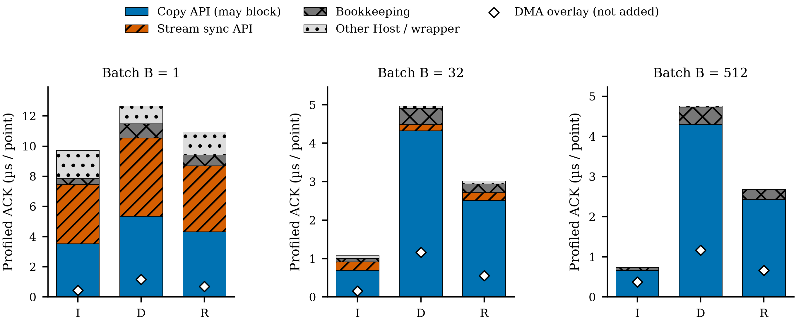
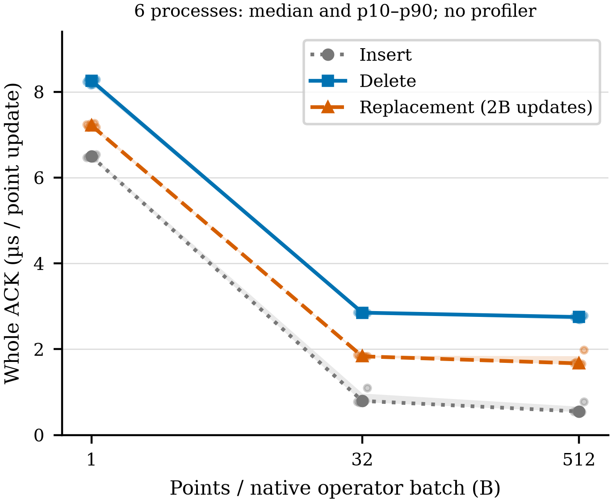
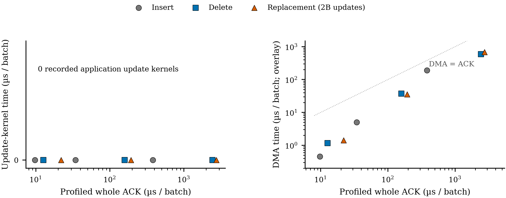
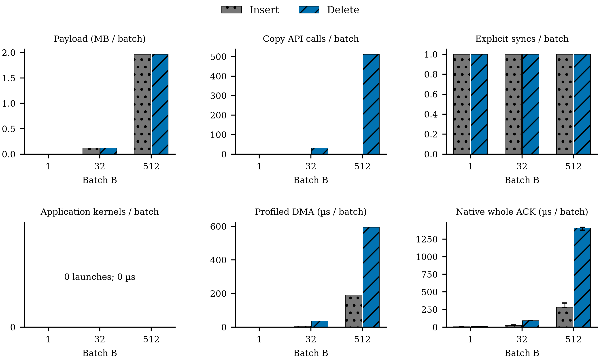

# Figure messages and QA

All four figures are **diagnostic evidence, not manuscript edits**. Numeric CSVs
are colocated with PDF(vector),SVG(vector) and400DPI PNG exports. Serif styling,
blue/orange/gray, shape/line/hatch redundancy and minimum7pt source text follow
the existing research figure style. PDF pages were rendered at400DPI and all
four visually inspected, plus full-resolution legend crops. No overlaps,
clipped labels or missing symbols were observed. See evidence/FIGURE_QA.json.

## A — Fine-grained copy APIs dominate large-batch delete

Exclusive Host partition of each profiled whole ACK, amortized per point update.
Runtime-copy APIs may block. Inner ownership/validation ranges subtract API
unions; remaining Host/wrapper gaps remain explicit. White diamonds are DMA
**overlays, not stacked fractions**. Independent NSYS processes cannot provide
native latency fractions;R uses2B points per replacement pair. Panels use
independent y scales. The matching unprofiled denominator is in TABLES.md.

## B — Batching amortizes the ACK but does not remove per-row delete work

Native no-profiler µs/point update versus native batch size. Lines are medians
of six process aggregates; bands are process p10–p90, **not confidence intervals**;
small points retain every process. R counts2B updates per pair. B512 has only16
pair/native ACKs per process, so it does not characterize a population tail.

## C — Zero application update kernels does not mean zero device activity

Each point matches whole ACK and device activity from the **same** profiled cell.
Left: zero recorded application update-kernel time. Right: nonzero DMA overlay
(log scale). The dotted equality reference is not an attainable-performance
bound. Required query kernels provide a positive visibility control. No exact
physical DRAM/L2-byte or complete driver-activity claim is made.

## D — Equal payload and waits, unequal copy-call granularity

At matched B, I/D request equal payload and one explicit sync but1 versus B copy
APIs in this workload. Update application kernels/launches are zero. Profiled
DMA remains separate from native ACK bars; native error bars retain six-process
p10–p90. Pure I/D initial states differ as declared in SCOPE.md. These panels
explain an existing path, not a measured optimized-delete speedup.
