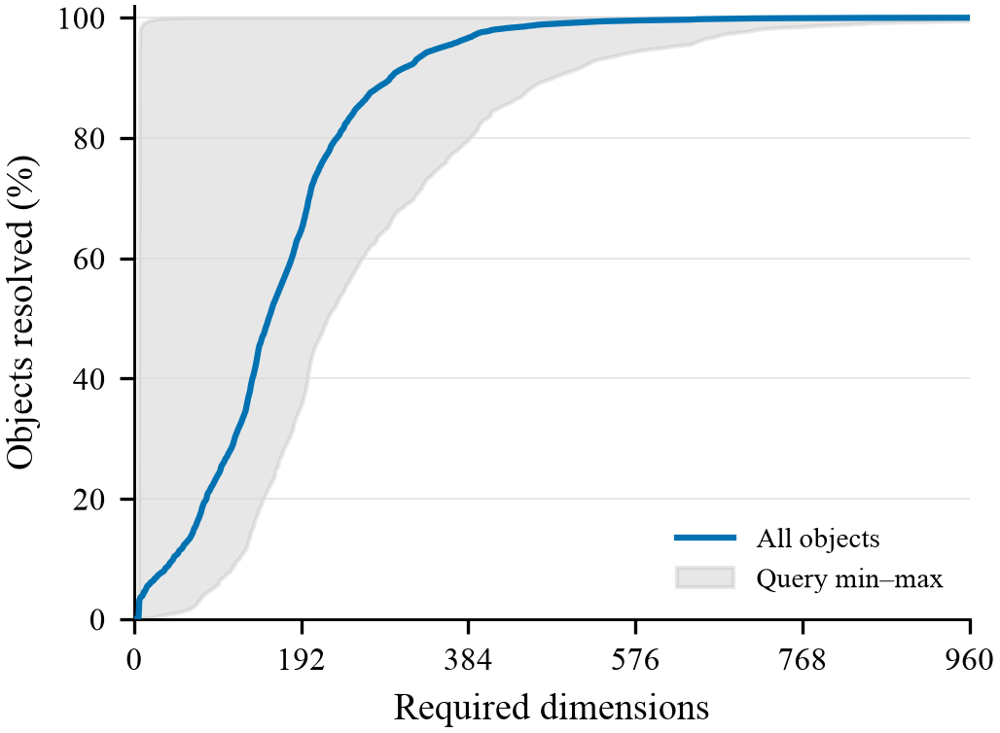
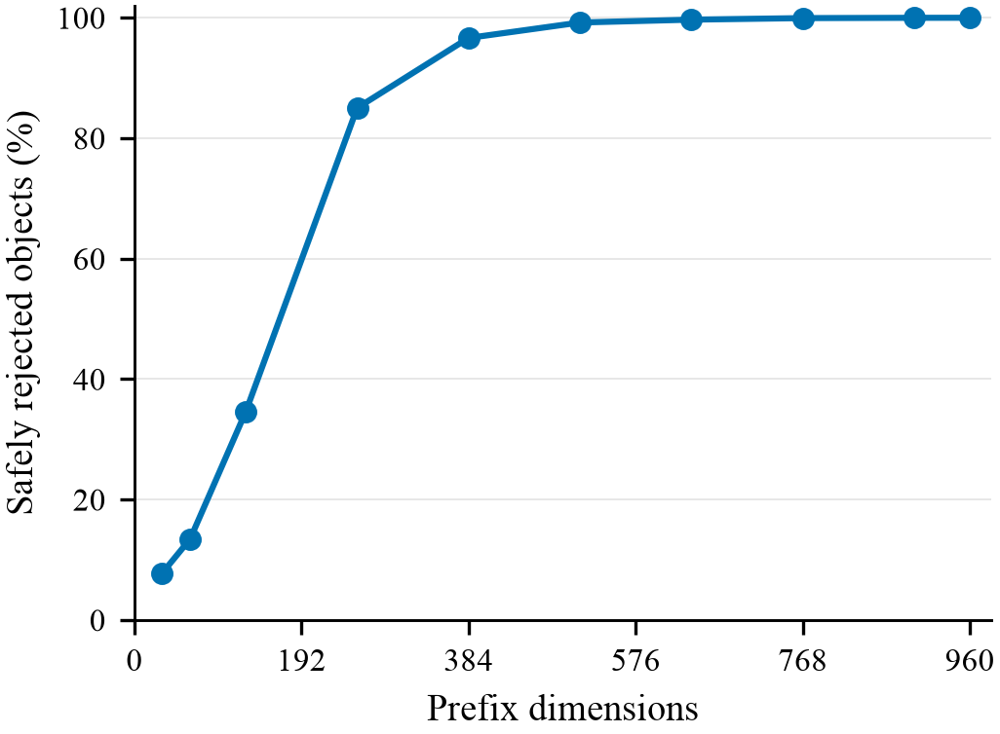
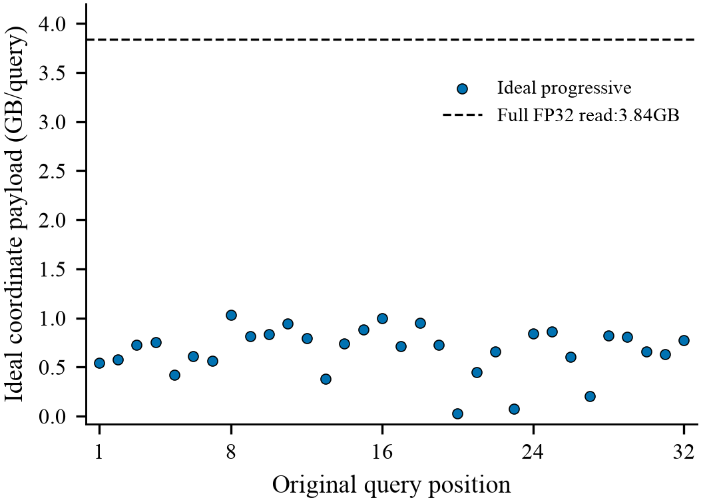

# Exact representation / progressive byte reduction Gate1

**GO_BYTE_REDUCTION**: mean **167.291615** dimensions; ideal coordinate payload **3.840000→0.669166GB/query**, reduction **82.573790%**.

GIST1M/D960, FP32 row-major, initial snapshot, original32 queries, original0..959 order, radius bits0x3f34a3d8. All32M pairs are measured offline. **This is counterfactual coordinate payload, not measured GPU traffic or speedup. Early abandoning is not novelty.** All32 query means are below384; the maximum remains below480. No query was selected or changed.

The parent strengthened baseline is commit939cd2e. No CUDA/kernel, coding, reordering, approximate arithmetic or dynamic workflow was introduced.

| Metric | Result |
| --- | --- |
| All-object mean / median dimensions | 167.291615 / 155.000000 |
| Object-level p90 / p99 dimensions | 295.000000 / 486.000000 |
| Query-mean p90 / maximum dimensions | 233.553414 / 257.853106 |
| Full / ideal bytes per query | 3840000000 / 669166459.000000 |
| True-hit pairs | 6590 |
| Full960 reference bit mismatches / false rejections | 0 /0 |
| GPU starts | 0 |

## Evidence

[Contract](CONTRACT.json) · [Numerics](NUMERICS.md) · [Prior art](PRIOR_ART.md) · [Decision](DECISION.md) · [Claim ledger](CLAIM_EVIDENCE.md) · [Reproduce](REPRODUCE.md) · [Costs](COST_LEDGER.md)

[Dimension distribution](required_dims/REQUIRED_DIMS.md) · [Checkpoints](checkpoints/CHECKPOINT_REJECTION.md) · [Byte headroom](bytes/BYTE_HEADROOM.md) · [Query robustness](bytes/PER_QUERY_ROBUSTNESS.md) · [Margins](margin/MARGIN_ANALYSIS.md) · [Design-only stage accounting](GPU_DESIGN_GATE.md)

Figure1: full32M-pair required-dimension CDF; gray range is the observed min/max of the32 complete query CDFs, not a CI. At960, hits are resolved by full evaluation.

Figure2: strict-safe rejection at the ten frozen checkpoints; the denominator includes hits, so the last point is the nonhit fraction.

Figure3: ideal coordinate payload for every original query, in original order; the dashed line is the full3.84GB coordinate payload, not a latency lower bound.

## Next action and boundary

GO admits design only. The staged payload and optional metadata proxies are not a total-cost or end-to-end proof. A future GPU campaign needs a conservative numerical contract, complete-output verification, full prior-art audit and charged control/update costs. Public source/scalars/hashes/figures only; raw data, scores, per-pair dimensions and placement stay private. No manuscript or production dispatch changed.
