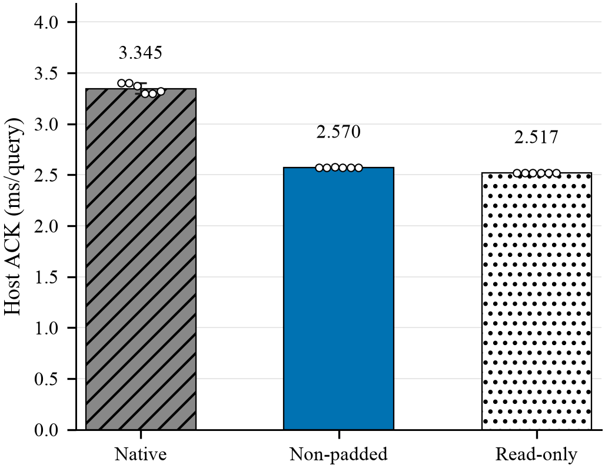
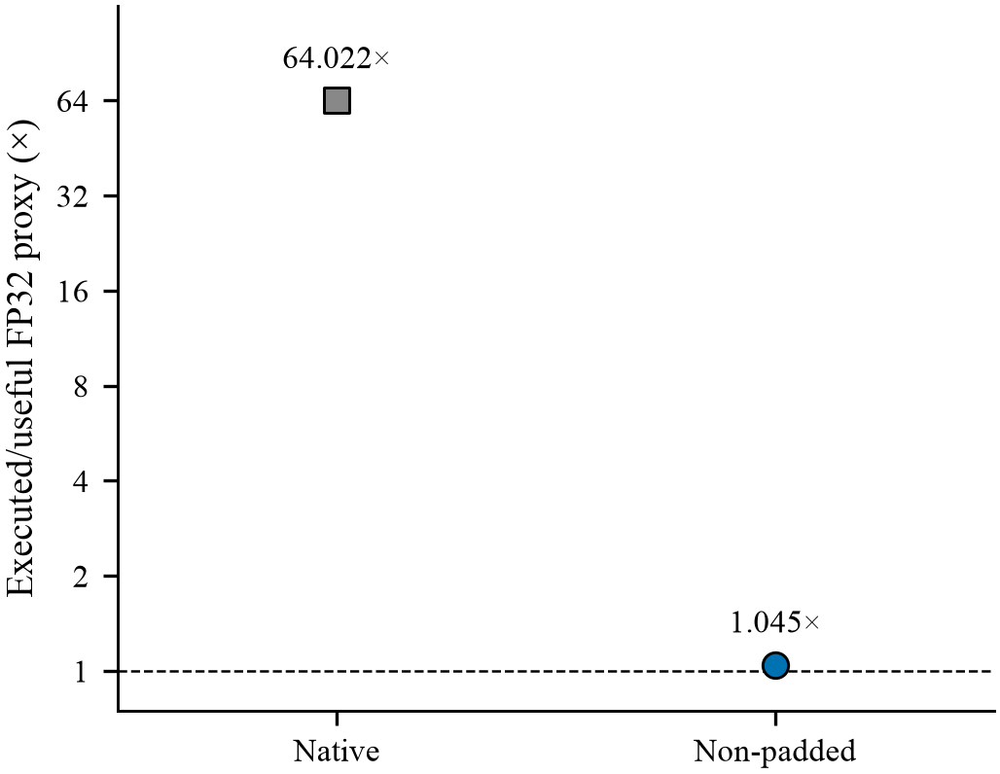
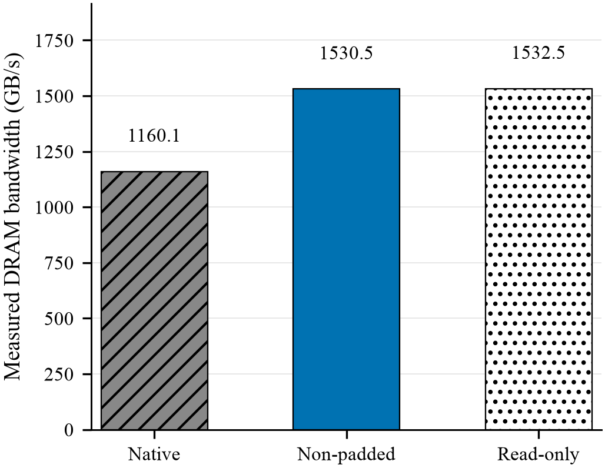

# Non-padded B1 exact-scan baseline strengthening

**Decision: `BASELINE_FIXED_MEMORY_LIMIT`.** Complete-output Host ACK decreased
from **3.345378 to 2.569716 ms/query (23.1861%, 1.301847×)**. All six matched
rounds won; the paired latency ratio was **0.767830**,95% CI
**[0.759850,0.775864]**. READ_ONLY was **2.517427 ms/query**.

This is **baseline strengthening, not GTSPP novelty**. The strongest caveat is
scope: GIST1,000,000×960, FP32 row-major, range B1, original fixed32 queries,
initial snapshot. Candidate fields satisfy the inherited tolerance, not native
bit identity. READ_ONLY is a checksum streaming control, not search or a
universal lower bound. The earlier `PARTIAL_PADDING` verdict is unchanged.

| Same-campaign mode | Median process-mean ACK (ms/query) | Role |
|---|---:|---|
| Native padded N0 |3.345378|Original complete-output keeper|
| Non-padded N1 |2.569716|Strengthened complete-output baseline|
| READ_ONLY R0 |2.517427|Structural control only|

N1 executed/useful FP32 proxy is **1.045155×**, versus N0 **64.022230×**.
Latency recovery is **93.6846%** (matched-round95% CI
**[93.2798%,94.1160%]**). N1/R0 is **1.020771**. Independent main-kernel DRAM
bandwidth is **1160.115 /1530.511 /1532.455 GB/s** for N0/N1/R0; the derived
bandwidth recovery is **99.4780%**, based on one capture/mode, without a CI.

The conditional336-event integration pair (40 insert,40 delete,128 range,
128 kNN; initial1M/D960) decreased inherited workflow wall from
**1336.345387 to1233.270291 ms (7.7132%)**. This is only **one forward pair**,
not a stable or sustained workflow claim. The range ACK sum decreased
**431.204220→329.552427 ms**; kNN stayed **862.761123→862.702277 ms**.

## Evidence and implementation

- [Frozen contract](CONTRACT.json), [prior-art check](PRIOR_ART.md),
  [design](DESIGN.md), [decision and Q1–Q5](DECISION.md),
  [claim ledger](CLAIM_EVIDENCE.md).
- [Static timing](timing/BASELINE_TIMING.md),
  [gap accounting](timing/GAP_ACCOUNTING.md),
  [kernel resources](profiler/KERNEL_RESOURCES.md),
  [short integration](timing/DYNAMIC_INTEGRATION.md).
- One warp/real row, eight warps/CTA; direct FP32 squared differences and warp
  reduction. Original threshold, stable compaction, fields, charged observer,
  full D2H, completion and timers are preserved. No compression, pruning,
  expanded L2, Tensor Core, tuning matrix or library patch.
-31/31 top-level starts:8 qualification,18 primary,3 independent NCU,1 old
  workflow,1 authorized remaining workflow. All runtime/isolation gates passed.
  A postrun reference-ownership false failure is retained: old output was
  rechecked offline, not rerun; only the remaining process was authorized.
- All40 static queries/run checked against ordered FP64;0 FN/FP. Synthetic
  duplicate/empty/boundary/tail/pointer/two-stream fixtures passed100 iterations
  and memcheck/racecheck/synccheck. This is not full-N sanitizer, Graph or
  all-shape production qualification.
- Static native median is modestly above the prior3.26–3.32ms band; no exact
  timing reproduction is claimed. Native binary/library/payload identity and
  the fresh same-campaign comparator are retained.

Figure1: medians of six process means, p10/p90 whiskers (not CI), all six points.
All complete-search outputs are charged; READ_ONLY is not a search method.

Figure2: one independent diagnostic/mode; logarithmic point plot, no invented
uncertainty. READ_ONLY search inflation is N/A and intentionally omitted.

Figure3: same-capture total DRAM bytes divided by kernel duration; one capture
each, not ACK throughput. Logical input size is3.84GB/query for all paths.

## Next action and publication boundary

Future scan-centric comparisons on this qualified scope must use the
strengthened baseline. The decision admits **only a separately frozen Exact
Representation / Byte Reduction Gate1 falsification**, not a new implementation.
Prove safe byte reduction, count certificate/refinement/update/consumer costs,
and kill subsumed ideas against prior art before GPU work.

See [reproduction](REPRODUCE.md). Only owned source, scalar receipts, hash
manifests and figures are public. Data, complete payloads, placement, build logs,
vendor reports and raw SASS remain private. Existing library/vendor and original
campaign files are untouched. Candidate dispatch is artifact-local, not a
production default. No manuscript, Overleaf project or confidentiality changed.
