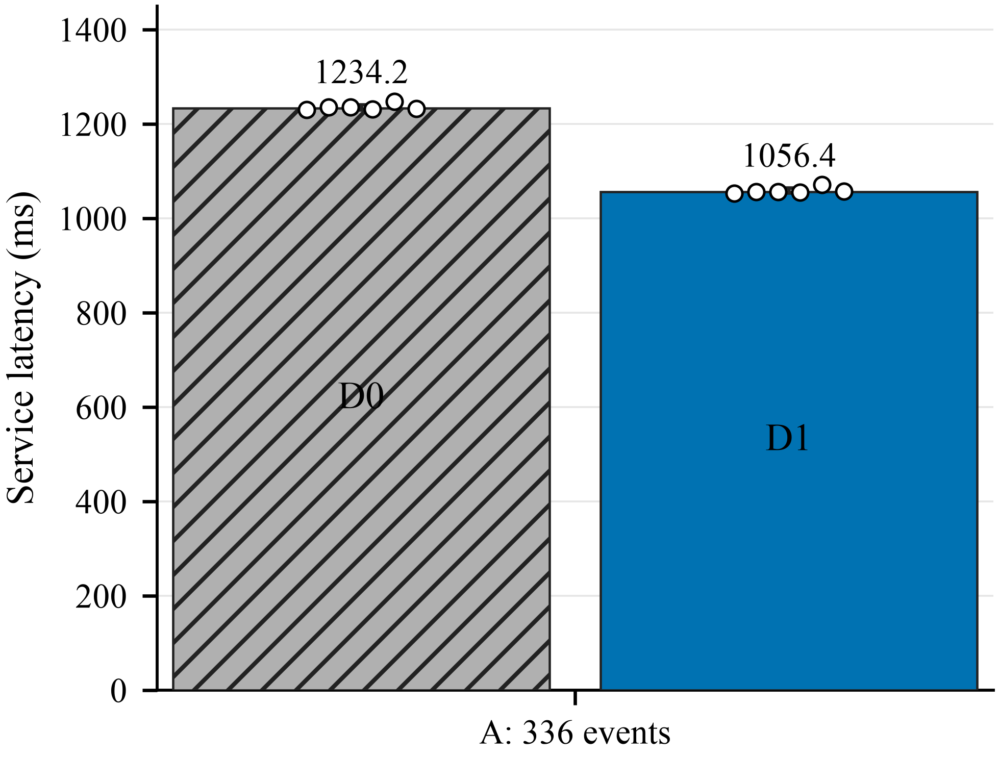
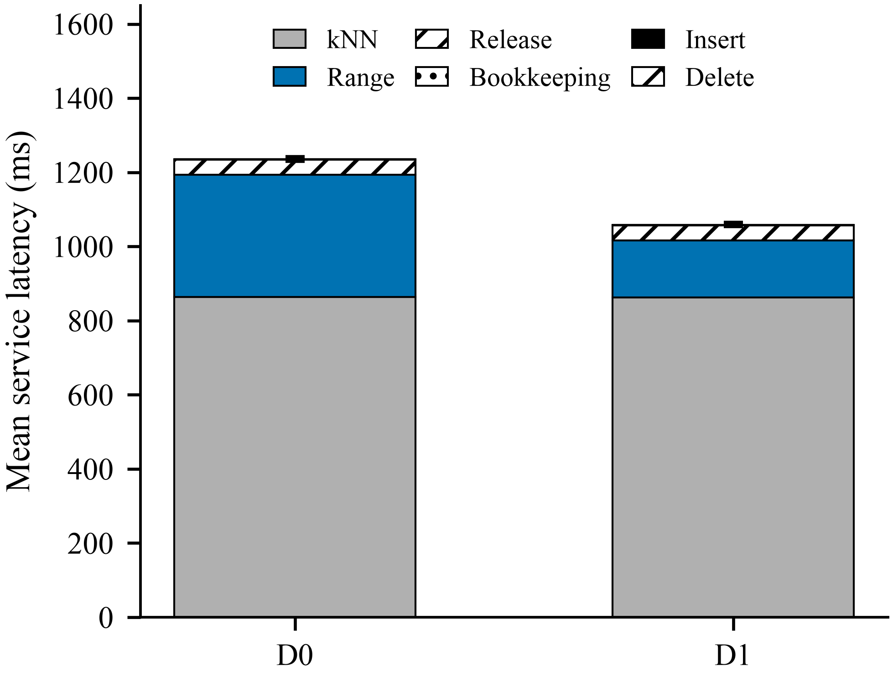
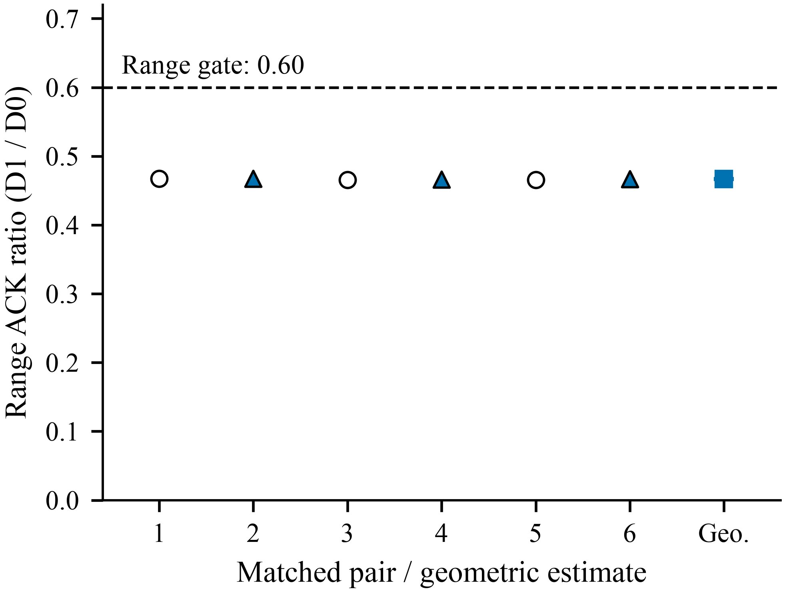
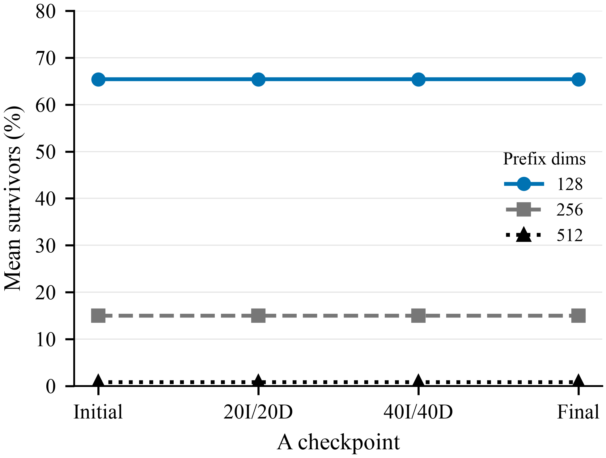

# Dynamic Progressive Integration Gate3

**Result: UNCLASSIFIED; B not executed; ENGINEERING_ONLY.** On GIST1M (1,000,000 FP32 vectors, D=960), the fixed 336-event workflow has 128 exact range requests, 128 native Faiss kNN requests (k=8), 40 inserts and 40 deletes. Six fresh paired rounds remeasure both systems, alternating order.

- Range total ACK median: 329.677093 -> 153.797929 ms; **53.35% lower**, 2.143573x.
- Segmented service median: 1234.190701 -> 1056.385958 ms; **14.41% lower**, ratio **0.855934141 > 0.85**. Six of six pairs improve, but the frozen >=15% GO gate fails.
- Insert/delete total ACK ratios: 1.036157/0.961227; no >1.5x update regression. Exact outputs and final state pass within the bounded trace.
- D1 adds 32,031,488 bytes of reusable O(N) query workspace, not an O(ND) persistent vector copy. No rebuild or changed kNN path.

The timer is **events + native/device/live-map release**, not complete process wall time. Full final-state validation is separately excluded; ordinary answer serialization and retained Host-container destruction happen after the timer. See [the retained deviation](TIMING_BOUNDARY.md). No broader complete-release claim is made.

## Mechanism and limit

Redundant coordinates after a safe rejection -> exact partial-distance rejection -> frozen 128/256/512/960 scan + stable compaction -> lower complete range ACK latency. The unchanged kNN path consumes 72.31% of D0 event time (mean of six per-process shares), limiting the observed workflow gain. Gate3 did not collect dynamic DRAM counters; Gate2 static traffic cannot be relabeled as dynamic evidence.

D0 keeps the strengthened non-padded scan; D1 changes only range and borrows the same raw-vector storage, stream and outputs. Updates append/swap-delete with identical logical-occurrence ownership. Progressive state is query-only, reserved before service ready and released at the charged device boundary. No tree, stored prefix index, representation reorder or production dispatch change.

## Evidence

| Gate | Status and scope |
| --- | --- |
| Source/input/binary/library freeze | Bound by SHA256; D0 distance SASS matches strengthened keeper, all five D1 progressive kernels match Gate2 |
| Qualification | 10/10 successful; memcheck/racecheck/synccheck on N=65/D960 synthetic fixtures, plus two full A dry runs |
| Formal timing | 12/12 successful; six matched fresh pairs, no extra probes in timed event streams |
| Correctness | Complete members, distance fields, multiplicity, mutation induction, actual full final maps and every final vector byte |
| Conditional B | NOT_EXECUTED, A was not GO |
| Novelty/thesis | Not admitted; prior partial-distance/cheap-update precedents remain binding |
| Launch accounting | 22 successful CUDA processes + one preserved pre-CUDA guard failure = 23/30 approved starts |

See [decision Q1–Q5](DECISION.md), [claim ledger](CLAIM_EVIDENCE.md), [novelty closure](NOVELTY_CLOSURE.md), [A samples/statistics](timing/TRACE_A.md), [memory](memory/README.md), [quality](correctness/README.md), and [reproduction](REPRODUCE.md).

## Figures

Vector PDF/SVG, 600-DPI PNG, source CSVs and [scope-bearing captions](figures/CAPTIONS.md) accompany all four plots. No B data is plotted.

## Publication boundary

This artifact publishes task-owned source, frozen logical event IDs, scalar observations and hashes. Private vector data, complete raw payloads, binaries, compiler/library placement, device identities and failure traces remain outside Git. [Raw identities](evidence/RAW_IDENTITY.json) are receipts, not the payloads themselves. The broader repository has pre-existing public history; this update is not an anonymous or whole-history-sanitized release. No manuscript or Overleaf content is included.
