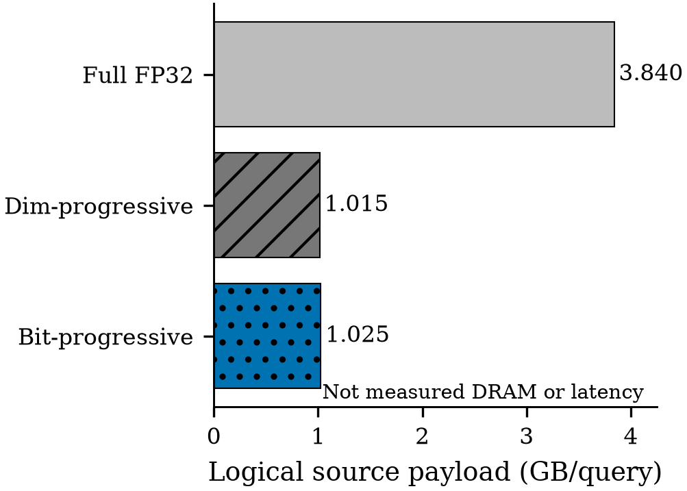

# Progressive lossless representation: fixed-schedule Gate0

**NO_GO_LOSSLESS_PROGRESSIVE. Gate1 was not run.**

The single encoded FP32 source is lossless and supports safe progressive range
rejection, but its **1.025475825 GB/query logical source payload** is **1.0491%
larger** than the frozen dimension-progressive checkpoint model. It exceeds both
the GO ceiling (0.7103801432 GB/query) and the conditional ceiling (0.85 GB/query).
This is a negative result for this representation and schedule, not a GPU
performance result or a rejection of every lossless progressive representation.

## Frozen experiment and result

GIST1M; N=1,000,000; D=960; original FP32; the prior Gate2's 32 range queries and
radius; unchanged row occurrences, coordinate order, and inclusive ordered-FP64
squared-L2 oracle. One query-independent source has four incremental layers:
4 + 4 + 8 + 16 bits, giving cumulative **4 → 8 → 16 → 32**.

| Search source | Logical payload/query (decimal GB) | Persistent database source |
|---|---:|---:|
| Full FP32 scan | 3.840000000 | 3,840,000,000 B |
| Dimension-progressive, 128/256/512/960 | 1.014828776 | 3,840,000,000 B; optional execution state separately priced |
| Ordered-key bit-progressive | **1.025475825** | **3,840,000,064 B**, including header |

These columns are ideal **distinct source-payload bytes** derived from exact
replay counts, not measured CPU reads, GPU DRAM, or latency. No fresh GPU baseline
was needed or measured because Gate0 rejected the candidate. Metadata, state,
proof arrays, and unimplemented GPU compaction are [listed separately](model/LOGICAL_BYTES.json).

| Cumulative bits | Input pairs | Rejected pairs | Survivors | Incremental payload/query (GB) |
|---:|---:|---:|---:|---:|
| 4 | 32,000,000 | 2,901 | 31,997,099 | 0.480000000 |
| 8 | 31,997,099 | 29,826,955 | 2,170,144 | 0.479956485 |
| 16 | 2,170,144 | 2,163,227 | 6,917 | 0.065104320 |
| 32 | 6,917 | 327 | 6,590 exact results | 0.000415020 |

Only **0.009065625%** of pairs reject after four bits. The first two layers alone
cost **0.959956485 GB/query**, already above the 0.85 GB stop threshold even if all
later work were free. Mean required bits/coordinate are **8.545631875**; median
and p90 are **8**, p95 and p99 are **16** (pooled 32M query-object pairs).

## Correctness and scope

- All **960,000,000 database coordinate bit patterns** recovered exactly from
  the stored layers; no original-vector pointer is passed to candidate search.
  The raw validation mapping is closed before queries. The external original
  dataset is retained for audit, not deleted or used as a search fallback.
- All **32,000,000 query-object memberships** agree with frozen raw-FP32 oracle
  scores: zero FN, zero FP; complete row-occurrence IDs and multiplicity match.
  All **6,917** full-decode scores agree bit-for-bit; **66,167,243** visited lower
  bounds were checked against the oracle and for monotonicity.
- Corner fixtures cover signs, subnormals, signed zero, infinity, and NaN
  payload recovery. Dense L2 admission rejects nonfinite coordinates/queries.
  Prefix intervals are exhaustively checked for all 4/8/16-bit prefixes; 32-bit
  singleton cases are sampled/corner-tested, not exhaustively enumerated.
- One bounded CPU population process; four workers, nice=10. **Zero GPU or NCU
  starts**. CPU wall time is operational provenance, not search performance.
  No CUDA correctness/sanitizer, actual traffic, paired latency, kNN, updates,
  training, or manuscript edits are claimed.

## Evidence and reproduction

[Contract](CONTRACT.json) · [Prior-art boundary](PRIOR_ART.md) ·
[Format](representation/FORMAT.md) · [Safe arithmetic](representation/INTERVAL_DECODER.md) ·
[Decision](DECISION.md) · [Claim ledger](CLAIM_EVIDENCE.md) ·
[Validation](VALIDATION.md) · [Reproduce](REPRODUCE.md).

Public files contain source, scalar observations, hashes, and figures. Original
vectors, the encoded 3.84 GB database, full proof arrays, private placement, source
PDFs, and the confidential manuscript are not published. The negative candidate
is archived as a diagnostic artifact, not composed into the keeper.
