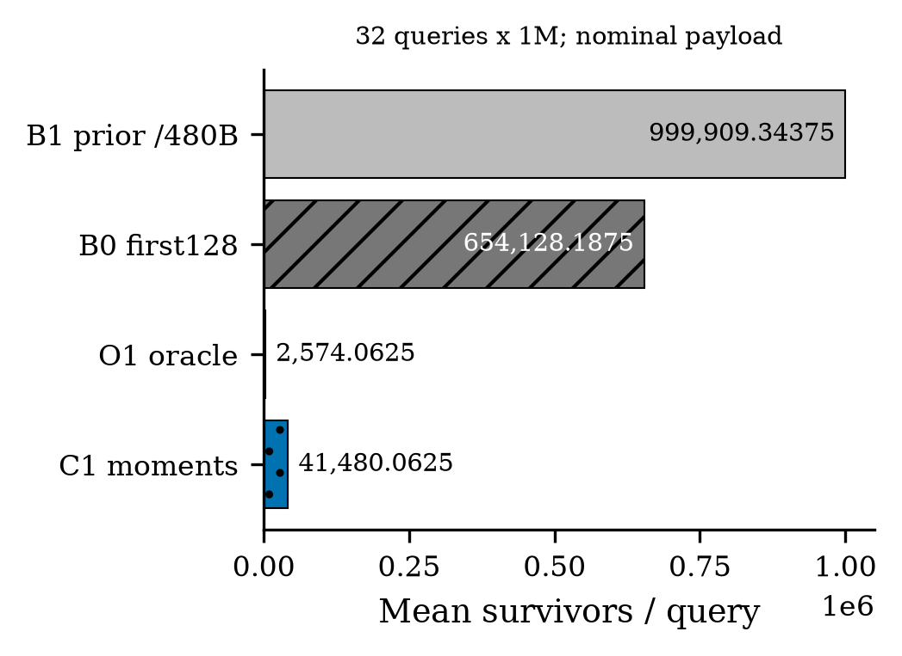
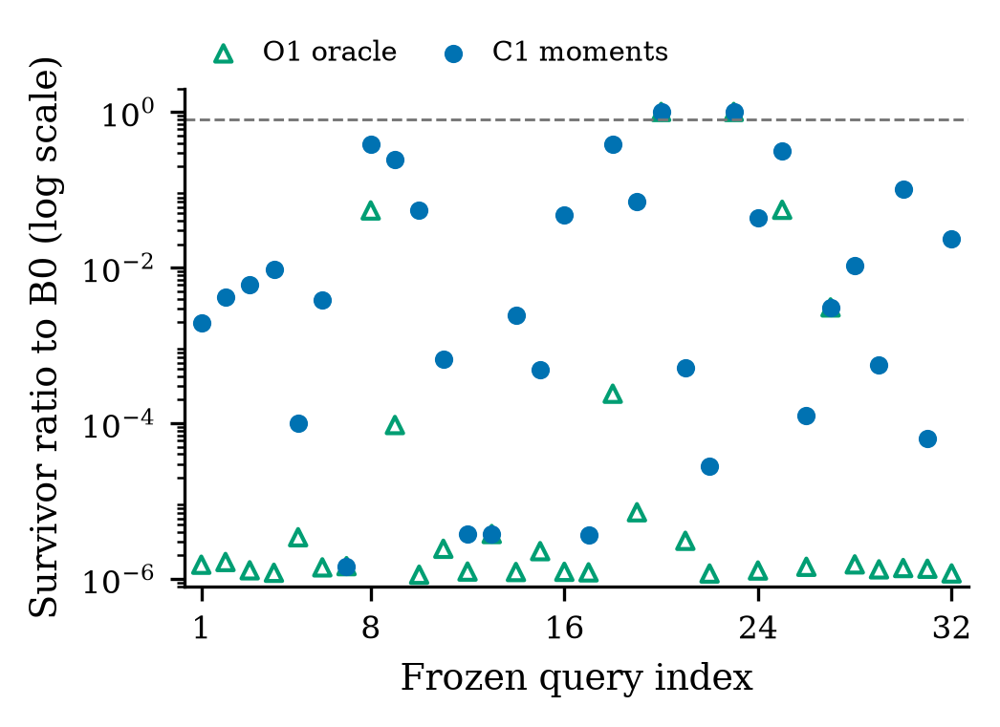
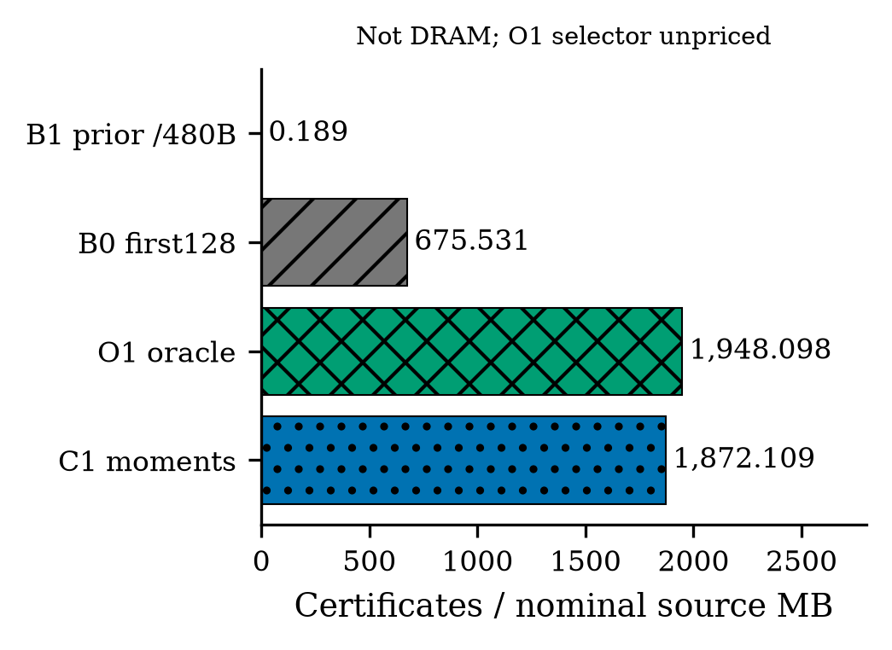

# Gate5: coordinate information changes certificate yield

**Numerical result: GO_PROOF_PER_BYTE_ROUTING. Research admission: NOT_DISTINCT_ENOUGH_TO_IMPLEMENT. No GPU run.**

GIST1M: **N=1,000,000, D=960**, original FP32, the same **32 frozen range queries** and cutoff as Gate2. Each population covers 32M query-object pairs. The selected-coordinate budget is 128 x 4 B = **512 B/object**: nominal source payload, **not measured physical DRAM**.

| Method | Mean survivors/query | Ratio to remeasured B0 | Selected payload/object | Scope |
|---|---:|---:|---:|---|
| B0 first128 | 654,128.1875 | 1.000000 | 512 B | Remeasured, exact parent-count parity |
| B1 bit4 control | 999,909.34375 | — | 480 B | Historical, not remeasured |
| O1 pair top128 | 2,574.0625 | 0.003935104 | 512 B nominal | Unpriced, reads all 960, not deployable |
| C1 moment score | 41,480.0625 | 0.063412743 | 512 B | One CPU coordinate probe |

C1 removes **93.6587%** additional survivors. Per-query ratio **p90=0.373234554**, below 0.80; median is 0.003977563. Maximum ratio is **1.0**: two queries already have one B0 survivor and cannot improve. This is not a universal per-query reduction or an end-to-end speedup.

O1 confirms substantial coordinate-family headroom; C1 realizes **94.0287%** of the B0-to-oracle survivor reduction. Statistics occupy **7680 B**, with no per-object metadata. All **96M saved partial bounds** are finite, nonnegative and no greater than frozen full scores, with **zero false rejection**. O1 also reproduces every full-score bit across 32M pairs. Complete search, kNN and updates are not run.

## Insight and boundary

Same 128-coordinate payload does not imply the same exact decision information. The 32 C1 sets are distinct; median pairwise overlap is 27/128. Median selected/full contribution rises from 0.115615 (B0) to 0.368315 (C1). Row-major cache-line/sector amplification remains unknown; these counts do not establish physical-byte or latency benefit.

The [routing audit](PRIOR_ART_ROUTING.md) rejects novelty admission. Query-adaptive exact partial-distance ordering has close prior art; variance alone is not a demonstrated distinct mechanism. Retain diagnostic/baseline-strengthening evidence, not a new paper contribution. Keeper and manuscript are untouched.

## Evidence

[Contract](CONTRACT.json), [decision](DECISION.md), [claim ledger](CLAIM_EVIDENCE.md), [all 32 query counts](analysis/QUERY_DISTRIBUTION.json), [overlap](analysis/OVERLAP.json), [contribution](analysis/CONTRIBUTION_CONCENTRATION.json), [margin](analysis/MARGIN.json), [exactness](quality/EXACTNESS.json), [numerics](NUMERICS.md), [costs](COST_LEDGER.md), [reproduction](REPRODUCE.md), [validation](VALIDATION.md).

Raw vectors, query coordinates, proof arrays, source PDFs and placement stay outside Git; manifests identify evidence. Figures are full frozen-pool counts, not repeated timings; no CI is invented. SVG companions and plotting code are included.

The dashed 0.80 line is the threshold for **p90** across queries, not a per-query requirement or the parity line (1.0).

