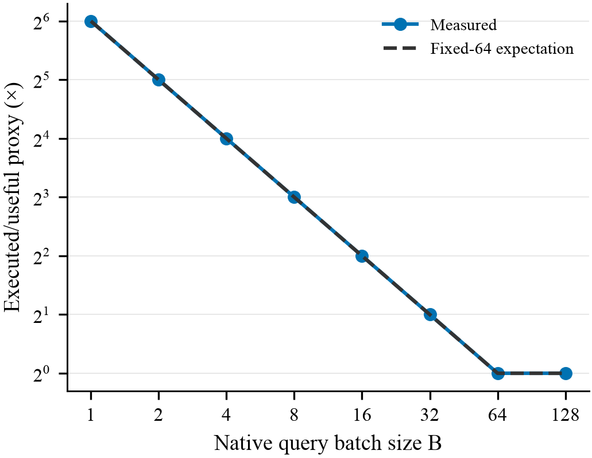
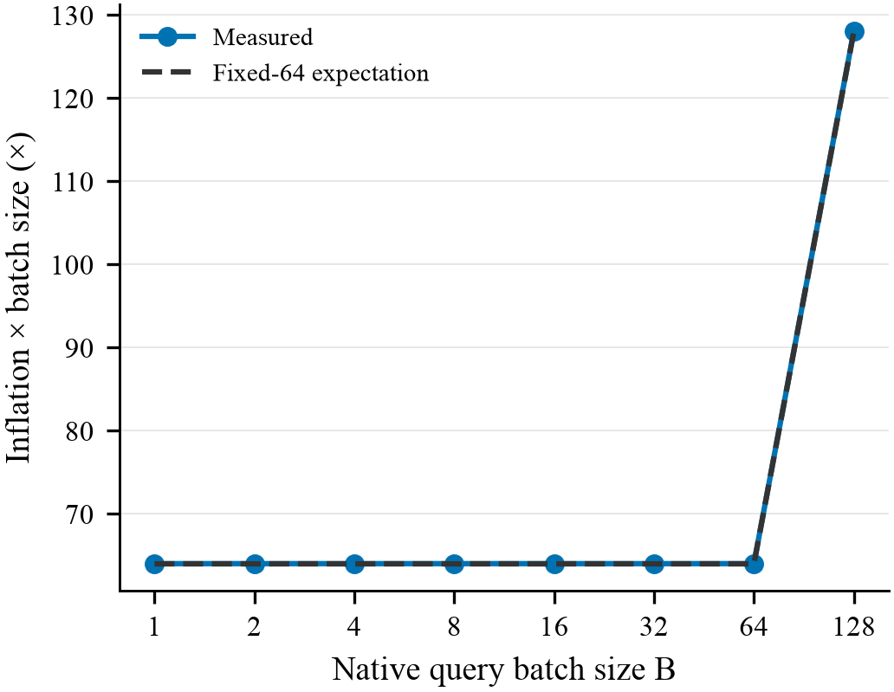
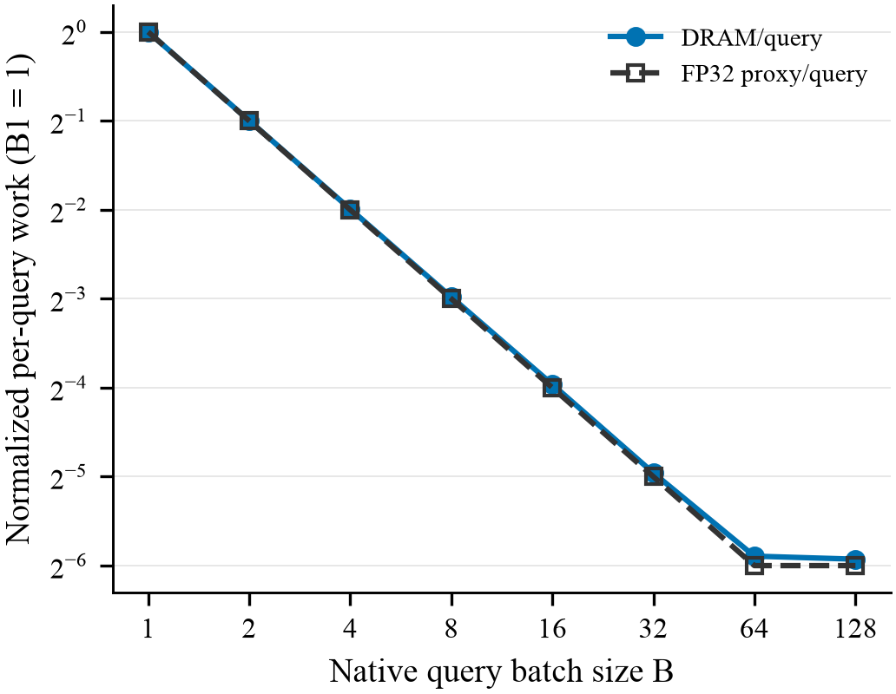
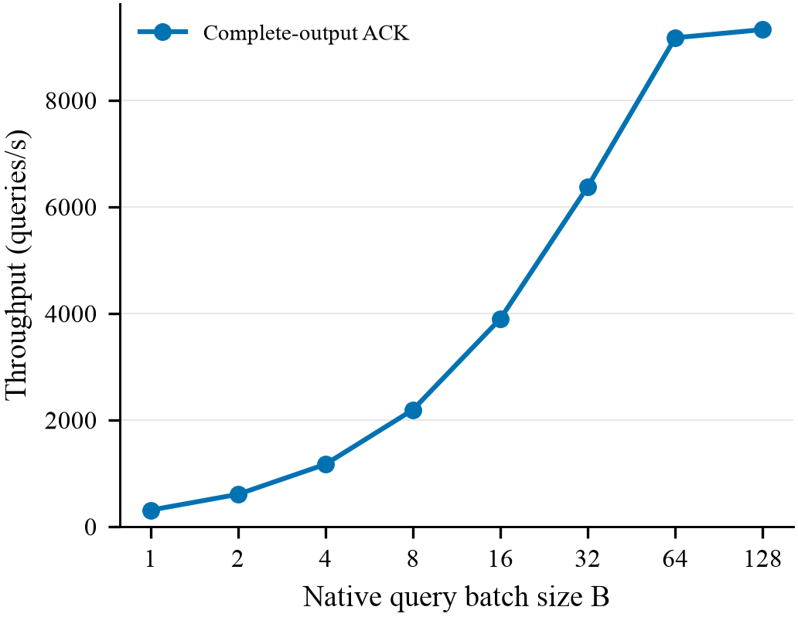

# Query-tile padding causal diagnosis

**Decision: PARTIAL_PADDING.** Fixed64 model median error **0.03473428%**; inflation **64.02223× → 1.00035×** (B1→B64). The strongest material caveat is the retained traffic gate: DRAM/query and FP32/query separation is **0.10656802 log2**, threshold≥1.

B128 changes grid **[376, 1, 1] → [188, 2, 1]** without changing selected-function identity. This corroborates a batch route, but the conservative geometric predicate fails because more than one axis changes; it is not a refutation of fixed64 arithmetic. No direct source constant was recovered.

Only dispatch/kernel-route provenance; no optimization. Preserve the original traffic gate and distinguish database reuse from repeated database loads.

## Scope and validation

- GIST1,000,000×960 FP32, L2Unexpanded, radius bits0x3f34a3d8; same cuVS26.8.1 containers, CUDA13.1 and RTX PRO6000 Blackwell Server Edition188SM/96GB; same privately pinned prior GPU/NUMA.
- Only a host batch driver was added; original B1 Scan::range and all original output kernels/compaction semantics are unchanged.
-75 guarded top-level starts:13 qualification (8 bounded shapes,3 sanitizers,2 target-scale),6 immutable original keepers,48 primary,8 independent NCU. No GPU failure/retry. One pre-GPU CPU allocation-alias failure is retained in ATTEMPTS.md.
- Complete membership versus ordered-FP64 oracle; native/field scale tolerance5e-5; B1 original payload identity. All output/report/source/input hashes independently reverified before curation.
- B≤32 uses original32 pool; B64/128 separately registered128 distinct queries.8 warmup+32 measured invocations/process. Cyclic repeats across invocations are disclosed; no duplicate within a batch.
- Primary scope: query H2D, native distance, full per-row output compaction/fields, charged observer/D2H, completion. Context/data loading/build/expanded workspace are outside ACK; continuous pass and setup metadata remain external.
- NCU one first-measured invocation/B, all native distance launches covered; NSYS confirms target B128 has one native launch. Profiler time is not primary timing.

## Results

1. [Executed work](counters/EXECUTED_WORK.md)
2. [Measured traffic](traffic/DRAM_SCALING.md)
3. [Launch geometry](geometry/KERNEL_GEOMETRY.md)
4. [Complete-output throughput](timing/BATCH_SCALING.md)
5. [Frozen models](models/TILE_MODEL_FIT.md), [decision](DECISION.md), [claim ledger](CLAIM_EVIDENCE.md)

Figures1–3 show single-invocation diagnostic counters without invented uncertainty. Figure4 shows six-process median QPS with p10/p90 whiskers, not a CI. Each figure is authored at3.5-inch single-column width. CSV + PDF/SVG/PNG outputs are included; optional repeated-single is N/A.

## Reproduction and publication boundary

See REPRODUCE.md. CONTRACT.json and measurement source were frozen before GPU execution. Exact libraries/data/keeper/CPU oracle/source/pools and scalar quality receipts are in evidence/. Full vectors, reference arrays, all complete payloads, private placement, vendor reports and SASS remain outside Git, indexed by hashes. The manuscript is untouched. This is baseline diagnosis, not GTSPP novelty or tree/workflow E2E benefit.
