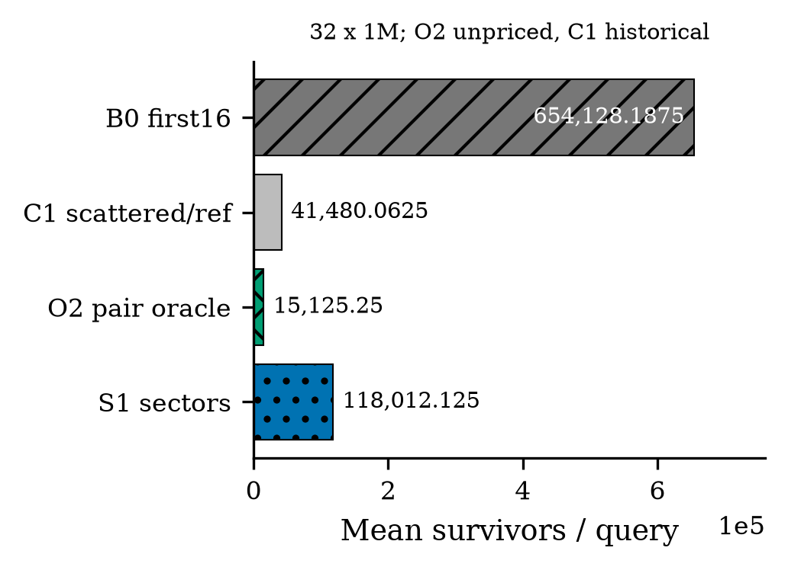
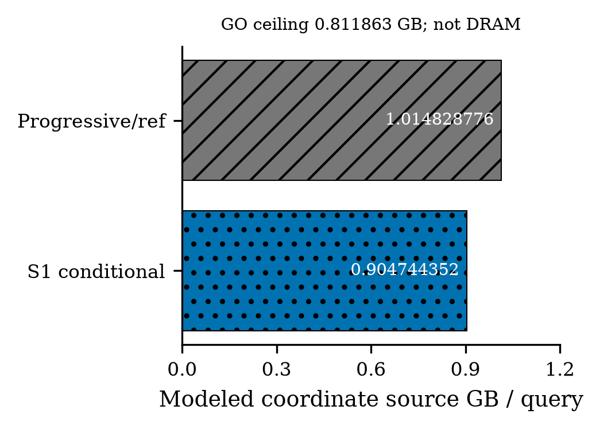
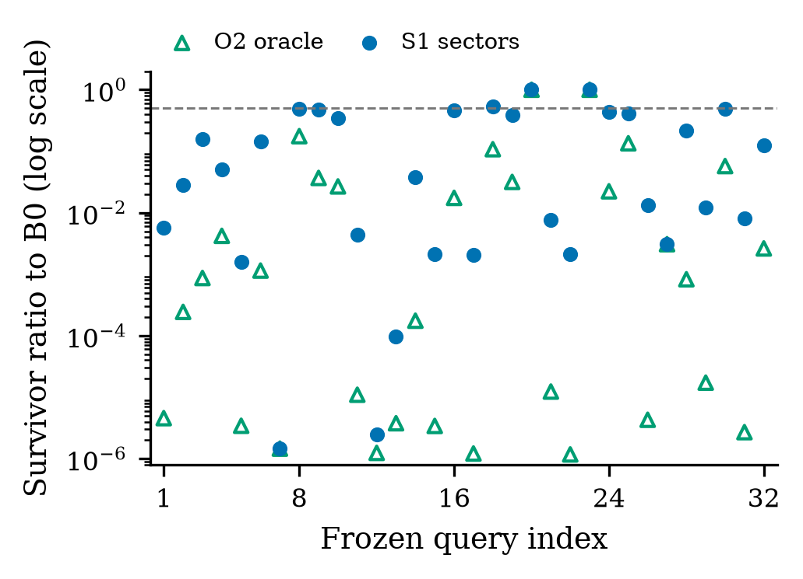
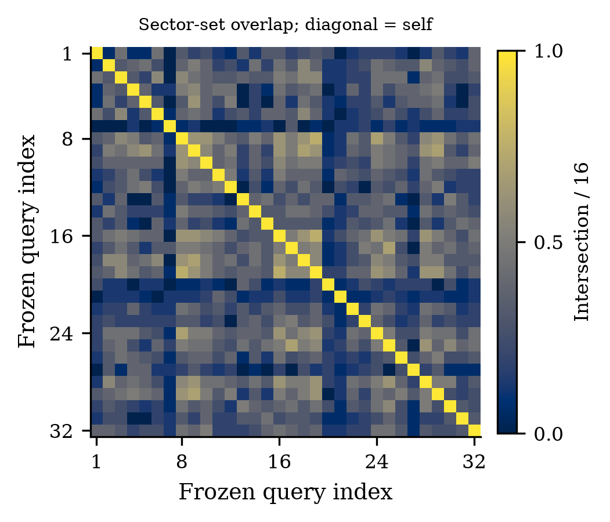

# Gate6: fixed-sector locality retains headroom, but misses the byte-margin gate

**Final diagnostic: CONDITIONAL_SECTOR_PROOF. Stop; zero GPU/NCU starts.**
GIST1M: **N=1,000,000, D=960**, original row-major FP32, the same **32 frozen
range queries** and inclusive cutoff as Gate5. Counts cover 32M distinct pairs.
The geometry is **16 x 32B sectors**, eight adjacent coordinates per sector:
512B of nominal selected payload/object, conditional on a device payload base
aligned to 32B. The unchanged CPU file has a 12B header; CPU mmap is not aligned
to that geometry. No GPU allocation or physical traffic is measured.

| Method | Mean survivors/query | Ratio to remeasured B0 | Role |
|---|---:|---:|---|
| B0 first16 sectors | 654,128.1875 | 1.000000 | Exact parent-count parity |
| Gate5 C1 scattered reference | 41,480.0625 | 0.063412743 | Historical, not sector-gate eligible |
| O2 pair top16 sectors | 15,125.25 | 0.023122761 | Unpriced oracle reading all 960 coordinates |
| S1 moment top16 sectors | 118,012.125 | 0.180411313 | The only sector probe |

O2 is **STRONG_SECTOR_HEADROOM**. S1 removes **81.9589%** additional B0 survivors
and realizes **83.8988%** of that oracle headroom, but its conditional
`512,000,000 + 3328 x survivors` model is **904,744,352 B/query** versus the strong
progressive-coordinate baseline **1,014,828,776 B/query**: only **10.8476%** lower.
The required 20% margin is missed. The exact GO byte ceiling is **811,863,020.8**.
Query-level ratio **p90=0.494019726** passes its 0.50 gate, so robustness does not
rescue the missed mean-byte condition. Two B0-saturated queries retain ratio 1.0.

## Boundary and decision

All **96M saved partial bounds** across B0/O2/S1 are finite, nonnegative and no
greater than frozen full scores; zero false rejection. O2 reproduces every full
score bit on 32M pairs; its numerical optimality guard finds zero ambiguous pairs.
Statistics are the unchanged Gate5 7680B moments; S1 has only 32B selected-sector
IDs/query and no persistent per-object metadata. Exactly two populations, no retry.

The source-byte model assumes previously read coordinates are retained without
reread. An arbitrary subset partial cannot simply be appended to the remaining
coordinates to reconstruct original-order FP64 full-score bits. Retention,
recomputation, register/shared storage, spills and other traffic are **unknown,
not priced and not assumed zero**. This is not complete-search execution, a
physical-traffic upper bound, latency or an end-to-end result.

The dedicated sector-routing novelty audit is **NOT_TRIGGERED**, not a DISTINCT
or SUBSUMED verdict, because numeric GO failed. No second heuristic, budget/layout
change, CUDA, keeper replacement or manuscript edit is admitted.

## Evidence and figures

[Contract](CONTRACT.json), [decision](DECISION.md), [claim ledger](CLAIM_EVIDENCE.md),
[all query counts](analysis/QUERY_DISTRIBUTION.json), [exactness](quality/EXACTNESS.json),
[conditional bytes](cost/FULL_FALLBACK_BYTES.json), [costs](cost/COST_LEDGER.md),
[numerics](NUMERICS.md), [reproduction](REPRODUCE.md), [validation](VALIDATION.md).
Raw vectors, queries, proof arrays, primary PDFs and placement stay outside Git.

The dashed 0.50 line is a **p90 threshold**, not a per-query requirement or parity.
These are complete fixed-pool counts, not repeated timings; no CI is invented.

