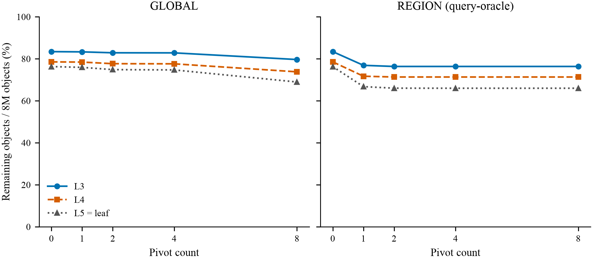
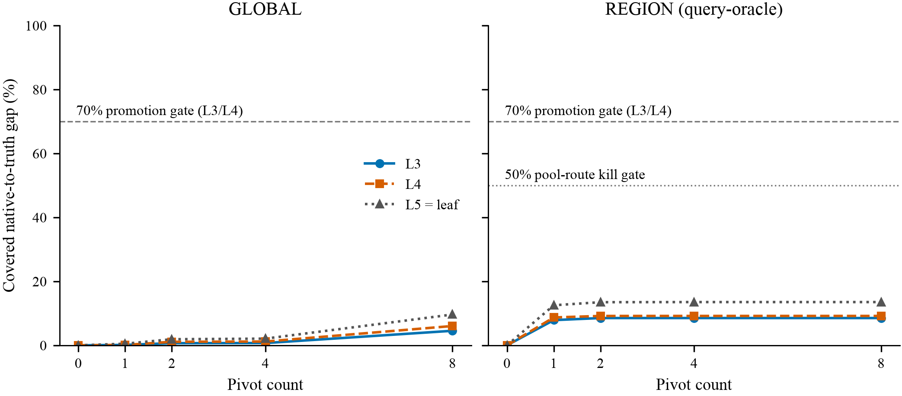
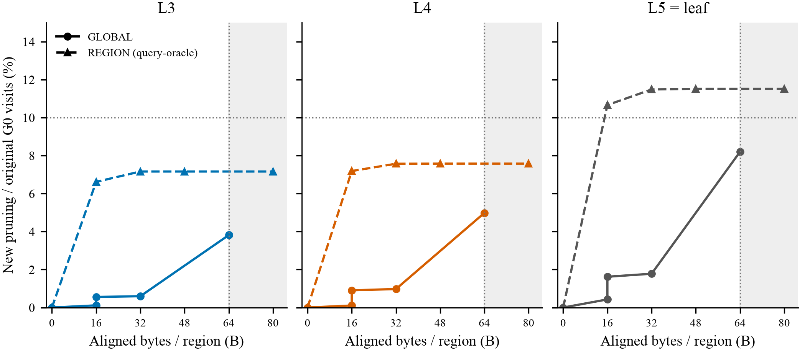
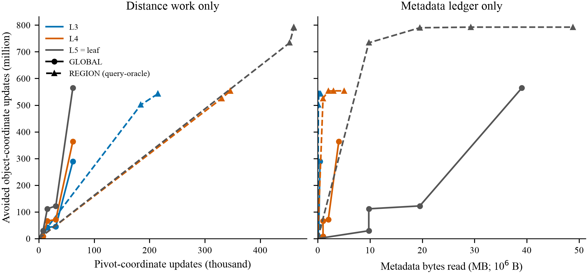

# Certificate compression kill test — GIST 1M, frozen eight queries

**Decision: `PIVOT_CERTIFICATE_KILLED` for the fixed 64-pivot pool and frozen
level-local interval contract. No GPU implementation is promoted.**
Ancestor truth leaves substantial counterfactual pruning headroom, but classical
GLOBAL-8 covers only 4.544082% / 6.041531% / 9.633969% of that gap at L3/L4/L5.
Even query-oracle REGION-8 covers only 8.529589% / 9.188991% / 13.526861%.
It exactly matches the entire 64-pivot pool's pruning envelope on these queries;
adding more dimensions from this **same pool and bound family** cannot rescue it.

This does **not** reject every possible pivot pool, combined geometry, projection,
partition, certificate, dataset, or GPU tree. It is not a latency or CPU/GPU-I/O
measurement. REGION selection uses the evaluation queries and is not deployable
or out-of-sample evidence. Classical pivot intervals are established prior art,
not a new contribution; see [PRIOR_ART.md](PRIOR_ART.md).

## Three questions answered

1. **Does ancestor-level truth allow pruning? Yes on this sample.** Perfect L3
   truth retains 0.587500% of all query-object pairs, against 83.387500% with
   current native bounds. L4 retains 0.072500%, against 78.508750%.
2. **How much can shared pivots compress? Little under this freeze.** GLOBAL-8
   has 64 aligned B/region but removes only 3.814956% / 4.980949% / 8.200811% of
   original same-level G0 visited work. All levels miss the 10% global work gate.
3. **Is region-specific selection substantially stronger? Better but insufficient.**
   REGION-4 fits 48 aligned B/region and already reaches the REGION-8 pruning
   result. The best pooled gap coverage is still only 13.526861%, below the
   predeclared 50% route kill gate. REGION-8 costs **80**, not 64, aligned bytes.

## Frozen contract and estimator

Base commit: `1f4d4ab05c66b4cc2411b7532a86517b823d53f9`. The original tree is unchanged:
same index bytes, pivots, splits, split margin, capacities, and G0 node-visit
trace. Data is finite FP32 GIST, N=1,000,000, D=960, K=8, B=1. Ordered RN-FP64
squared L2, no FMA/reassociation, ranks by `(score, row ID)`. The independent K-th
score fixes U*. The eight development queries are the previous stratified slice,
not a random population: its old G0 leaf-visit mean is 89.591750%, not the old
32-query mean of 94.927844%.

| Level | Regions | Objects/region | Current residual | Truth residual | Certificate headroom | G0 visited objects |
|---|---:|---:|---:|---:|---:|---:|
| L3 | 1,000 | 1,000 | 83.387500% | 0.587500% | 82.800000 pp | 7,890,000 |
| L4 | 10,000 | 100 | 78.508750% | 0.072500% | 78.436250 pp | 7,611,000 |
| L5 = leaf | 100,000 | 10 | 76.271500% | 0.007500% | 76.264000 pp | 7,167,340 |

Residuals pool **8,000,000 query-object pairs**. Incremental work uses the
original G0 visits **at the same level** as its denominator. Oracle gap coverage
is `(C0 residual - candidate residual)/(C0 residual - truth residual)`, pooled
before division, not an average of query ratios. Earlier threshold-only pruning
is never counted as a new certificate benefit. Levels cannot be added together;
L5 and leaf are the same partition, not independent observations.

The candidate is `max(unchanged full native path bound, new level-local interval
bound)`. New intervals are **not composed over multiple ancestor levels** with
unaccounted metadata. Native bounds retain the original first-two-level skips,
0.01 split margin, and 1e-6 guard. Source pool: 11,099 distinct originally queried
pivot rows; uniformly choose 64 without replacement with seed 20261011, then
sort. GLOBAL farthest-first is query-independent, seeded at the lowest row ID,
ties by lowest row ID, nested at 0/1/2/4/8. REGION greedy covers newly prunable
base-surviving query-region pairs, using all eight frozen queries; ties use the
lowest unused row ID. No geometric, sampling, or gate parameter was fit after
the result.

## Measured result matrix

The full 30-cell matrix and all 240 per-query cells are in
[per_level_summary.csv](evidence/per_level_summary.csv) and
[per_query_summary.csv](evidence/per_query_summary.csv).

| Mode | Level | Pivots | Residual | Gap coverage | Additional G0 work pruned | New objects | Aligned B/region |
|---|---|---:|---:|---:|---:|---:|---:|
| GLOBAL | L3 | 8 | 79.625000% | 4.544082% | 3.814956% | 301,000 | 64 |
| GLOBAL | L4 | 8 | 73.770000% | 6.041531% | 4.980949% | 379,100 | 64 |
| GLOBAL | L5 | 8 | 68.924250% | 9.633969% | 8.200811% | 587,780 | 64 |
| REGION_ORACLE | L3 | 4 or 8 | 76.325000% | 8.529589% | 7.160963% | 565,000 | 48 or 80 |
| REGION_ORACLE | L4 | 4 or 8 | 71.301250% | 9.188991% | 7.575877% | 576,600 | 48 or 80 |
| REGION_ORACLE | L5 | 4 or 8 | 65.955375% | 13.526861% | 11.514593% | 825,290 | 48 or 80 |

REGION-2 already reaches the full-pool L3 pruning envelope; REGION-4 reaches it
at all levels. Greedy selection need not optimize every smaller budget, but eight
choices suffice to cover the union of all candidate prune masks over **eight
queries**: while an uncovered bit exists, some unused pivot has positive gain.
The implementation checks that equality for every region. This upper-envelope
argument does not transfer to more than eight queries or different bound families.

**Material exception:** the route is not uniformly weak for every query.
REGION-8 leaf gap coverage for query 660835 is 76.147094%; its original G0 visits
are relatively low. The six high-visit queries have coverage from 2.349514% to
25.945477%. Query 90208 has 37.022816%. The predeclared pooled estimator rejects
the route; do not replace it with the favorable query or claim zero benefit.

## Real metadata and four separate cost ledgers

| Pivot count | GLOBAL logical / aligned B | REGION logical / aligned B |
|---:|---:|---:|
| 0 | 0 / 0 | 0 / 0 |
| 1 | 8 / 16 | 9 / 16 |
| 2 | 16 / 16 | 18 / 32 |
| 4 | 32 / 32 | 35 / 48 |
| 8 | 64 / 64 | 70 / 80 |

Each pair stores outward FP32 lo/hi. REGION also stores packed six-bit pool
indices; records are actually serialized with zero padding to 16-byte alignment.
The shared 64-row ID table, selected FP32 pivot vectors, and per-query FP64
distance cache are separate columns, not hidden free metadata. GLOBAL uses a
shared ID list. Bounds retain the conservative arithmetic envelope derived in
[SAFETY.md](SAFETY.md), not an epsilon obtained from sampled failures.

Example L5 pooled ledger, all costs incremental to the same C0/U*:

| Candidate | Avoided object-coordinate updates | Pivot-coordinate updates | Metadata bytes read | Bound evaluations | Scalar-bound-op proxy |
|---|---:|---:|---:|---:|---:|
| GLOBAL-8 | 564,268,800 | 61,440 | 39,051,008 | 4,881,376 | 39,051,328 |
| REGION-4 | 792,278,400 | 460,800 | 29,288,256 | 2,440,688 | 19,527,904 |
| REGION-8 | 792,278,400 | 460,800 | 48,813,760 | 4,881,376 | 39,053,408 |

One full D-dimensional distance means 960 coordinate updates. Query-pivot work
charges the union of selected IDs per level, without assuming native-cache reuse:
GLOBAL-8 needs 8 distances/query; REGION-4/8 need **28 / 45 / 60** at L3/L4/L5,
not four or eight globally. Even REGION-1 needs 24 / 43 / 59. Metadata proxy is
`base-surviving query-regions × aligned bytes`, with no cache model. Bound count is
`base-surviving query-regions × k`, without early exit. Scalar-op proxy is
`8 × bound evaluations + 5 × unique query-pivot distances`; three outward
nextafter operations per bound are counted separately. These are accounting
conventions, **not SASS counts, measured DRAM traffic, online cost or latency**.
Remaining object-coordinate work is also counterfactual, not the cost of the
offline scalar scan. Positive workload leverage does not override the route gate.

## Correctness and provenance

- Stage A matches all **888,880** native G0 node-visit bits. L5 C0 residual is
  exactly 6,101,720/8M, and leaf truth exactly 600/8M.
- Generated C++ differs from the admitted eight-query exporter only in its
  bounded query-count check. Full scalar score and top-K arithmetic are unchanged.
- The 64×1M pivot scan matches all **512 FP64 query-pivot scores (4,096 bytes)**
  against the previous eight-query full score export. The 64×64 pivot-pair score
  matrix is bitwise symmetric. The historical worker JSON key
  `query_pivot_score_bytes_checked: 512` is misnamed: it counts scalar score
  entries, not bytes; the raw receipt is preserved without silently rewriting it.
  The delivered worker corrects that field to 4,096 and adds the explicit
  512-entry field; its arithmetic is unchanged.
- 128 pivot-leaf pairs were frozen before collection. Separate Python scalar
  loops recompute their **1,280** distances bytewise and reproduce the interval
  source min/max values.
- **56,832,000** candidate bounds across every query-region-pool combination
  have zero safety violations. All selected combinations pass nested-bound and
  nested-pruned-set checks and zero false top-K prunes. REGION-8 equals the full
  64-pool prune envelope at all levels.
- Eight regression tests pass. Fresh staged replay reproduces every numeric CSV
  byte and selected metadata byte; receipts retain source/input/output hashes.
- CPU-only scan: 55.534961 s wall / 52.475661 s CPU-user, one low-priority pinned
  x86_64 CPU thread, g++ 13.3.0, NumPy 1.26.4. Analysis uses Python 3.13.12 /
  NumPy 2.4.3. These times are **offline preprocessing receipts**, not GTS or
  certificate query latency. No GPU context, GPU timing, sanitizer, sustained
  benchmark, new model or new partition was run.

See [evidence/RAW_MANIFEST.json](evidence/RAW_MANIFEST.json) for large private
outputs/log hashes, and [evidence/CERTIFICATE_VALIDATION.json](evidence/CERTIFICATE_VALIDATION.json)
for every serialized metadata receipt. Original data/vectors, 512MB pivot scores,
full interval arrays, metadata records, binaries, and machine paths stay outside
Git. Compact portable receipts and summaries are committed.

## Four figures



**Figure 1.** Most objects remain even with query-oracle pivots. Residuals pool
8M query-object pairs at fixed U*. L5 is leaf; there is no duplicated leaf curve.



**Figure 2.** All pooled pivot certificates fall far below the predeclared gap
gates. REGION saturates by four pivots; the 70% promotion gate additionally
requires L3/L4, >=10% additional G0 work and <=64 aligned B/region.



**Figure 3.** Added metadata cannot buy the required ancestor-level pruning.
The shaded area exceeds the 64B budget; REGION-8 costs 80B. The horizontal line
is 10% incremental original same-level G0 visits, not all-object fraction.



**Figure 4.** REGION-8 adds cost without more avoided work than REGION-4.
The two x axes deliberately separate distance-coordinate work from metadata
bytes; their incompatible units are never added or converted into latency.
All figures use complete deterministic cell counts, no invented uncertainty
bands. PDFs are vector with embedded non-Type-3 fonts; rendered pages and
high-DPI crops are checked. See [evidence/FIGURE_QA.json](evidence/FIGURE_QA.json).

## Reproduction

Run from the repository root. Python 3.10+, NumPy and matplotlib suffice for
analysis/plots; the worker additionally needs g++/numactl/nice/flock on Linux.
Set `DATA`, `INDEX`, and `PRIOR_SCORES` to authorized external inputs matching
[INPUT_IDENTITY.json](evidence/INPUT_IDENTITY.json). If full prior scores are
unavailable, reproduce them with the preceding
[region truth experiment](../region_truth_diagnosis_20261011/README.md).
Do not rebuild a different index or change the query slice.

```sh
TASK=research/certificate_compression_20261011
BASE=research/certified_navigation_20261010
python -m unittest discover -s "$TASK" -p 'test_*.py' -v
python "$TASK/freeze_and_ancestors.py" --index "$INDEX" \
  --scores "$PRIOR_SCORES" --out "$TASK/local/stage-reproduce"
python "$TASK/prepare_worker.py" "$TASK/local/build-reproduce"
# Inspect ancestor decision first. Stop if PARTITION_LIMITED.
# The measured worker pins CPU 48 / NUMA 3. Recheck topology, permission and
# existing users before running on another host; use --cpu/--numa to override
# these defaults there. A changed pin is not the same timing receipt.
# Never interrupt foreign work. No GPU dependency.
env CUDA_VISIBLE_DEVICES= OMP_NUM_THREADS=1 OPENBLAS_NUM_THREADS=1 \
  MKL_NUM_THREADS=1 PYTHONPATH="$BASE" \
  flock -n "$TASK/local/scan.lock" \
  python "$TASK/run_pool_cpu.py" --data "$DATA" --index "$INDEX" \
  --stage "$TASK/local/stage-reproduce" --build "$TASK/local/build-reproduce" \
  --out "$TASK/local/pool-reproduce"
python "$TASK/evaluate_certificates.py" --stage "$TASK/local/stage-reproduce" \
  --pool-run "$TASK/local/pool-reproduce" --out "$TASK/local/eval-reproduce"
python "$TASK/plot_certificates.py" --analysis "$TASK/local/eval-reproduce" \
  --out "$TASK/local/figures-reproduce"
```

All output directories must be new; failures and negative evidence are retained.
The scalar child has a 240s timeout. The figures have a native matplotlib
fallback; the optional installed style helper is neither required nor vendored.
Compare numeric CSVs, pivot selection, metadata and input hashes, not elapsed
times, compressed-container timestamps or PDF creation timestamps. Stage C
runs only if GLOBAL promotion fails. See [DECISION.md](DECISION.md) for the
negative-evidence boundary and the next research admission rule.
