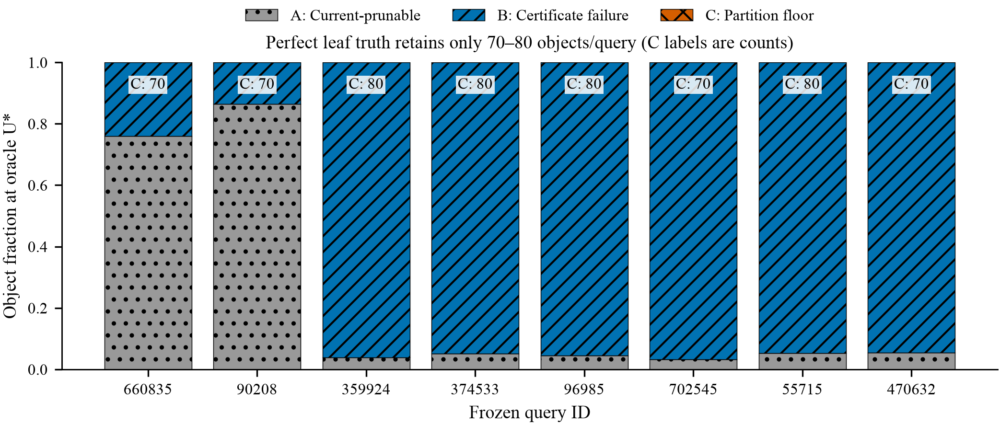
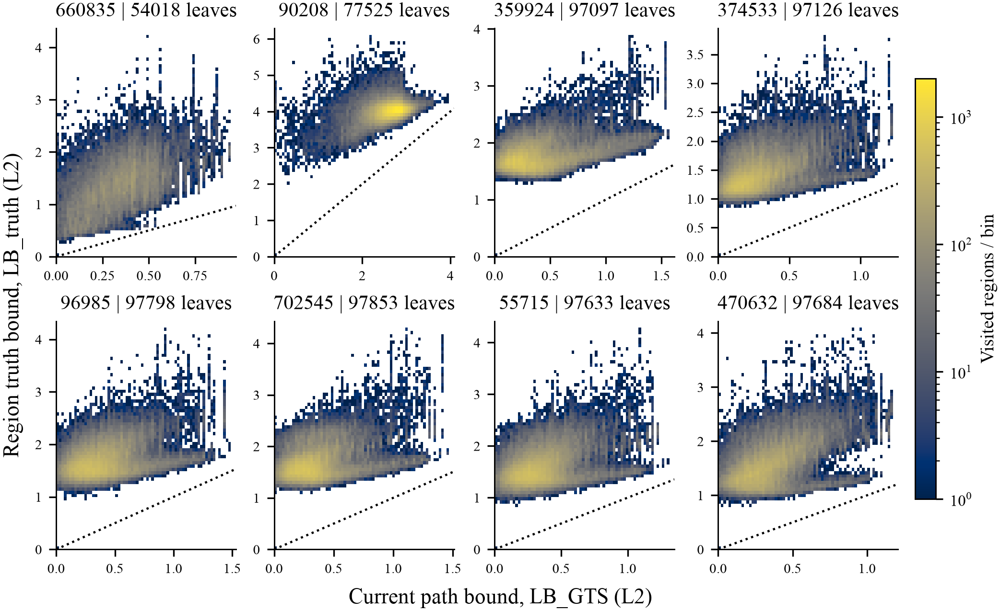
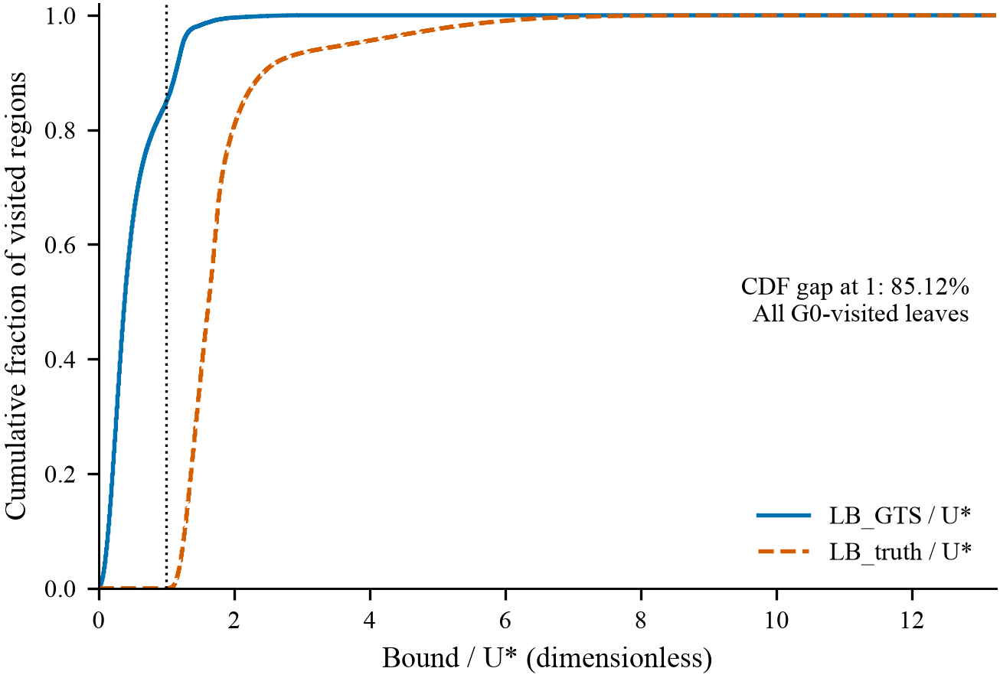
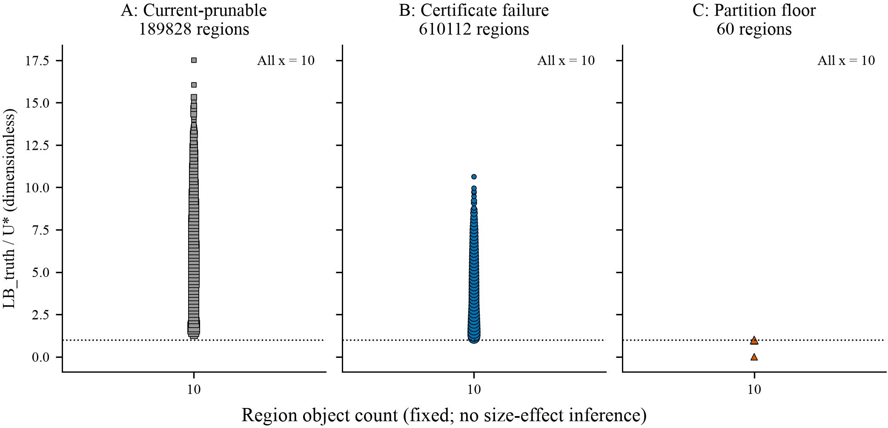

# Region truth diagnosis — GIST 1M, eight frozen queries

**Decision: CERTIFICATE_ROUTE under the pre-registered terminal-region rule.**
Of 7,167,340 object visits, 85.123909% are certificate failures at oracle U*,
14.867719% are already prunable with the existing bound at that tighter radius,
and 0.008371% lie in truth-retained leaves. This is an offline information
headroom diagnosis, **not a feasible certificate, an index-quality verdict, or
a measured speedup**.

The terminal partition is exceptionally fine: 100,000 leaves of exactly ten
objects. Each query has exactly eight objects at or below U* (one K-th boundary
object; no additional boundary ties). Thus perfect truth can retain at most
80 objects/query regardless of many aspects of partition quality. The observed
70–80-object floor does not establish a novel mechanism or rule out upper-level
partition/pivot weaknesses. Figure 4 cannot estimate any size effect.

## Scope and denominator

Base: `b800019240a42fe5409e2643816368730a1161f3`, repaired-original true-tree G0.
Same FP32 inputs, N=1,000,000, D=960, K=8, B=1, original index bytes, branch factor,
leaf capacity, pivot IDs, split margin, and ordered RN-FP64 squared-L2 score
contract. No tree rebuild or new GPU execution was performed. The score exporter
reuses the frozen scalar CPU oracle, with unchanged arithmetic/top-K ordering;
its full result matches the previously frozen independent exhaustive output.

This deliberately stratified **eight-query** slice visits **89.591750%** of N on
average, not the old 32-query mean of 94.927844%. Do not substitute its mean for
that population or pool it with older oracle-U diagnostics. The estimator pools
visited objects across the eight queries; the mean of per-query M1 is a different
number (81.124162%), retained in the JSON.

| Weighting | A: current-prunable at U* | B: certificate failure | C: truth-retained | Denominator |
|---|---:|---:|---:|---:|
| Region | 189,828 (23.728500%) | 610,112 (76.264000%) | 60 (0.007500%) | 800,000 query-region pairs |
| Object | 1,898,280 (23.728500%) | 6,101,120 (76.264000%) | 600 (0.007500%) | 8,000,000 query-object pairs |
| G0-visited object | 1,065,620 (14.867719%) | 6,101,120 (85.123909%) | 600 (0.008371%) | 7,167,340 actual leaf-object visits |

Region and object fractions coincide because all leaves contain ten objects.
The plan's label `PARTITION_FAILURE` is retained in machine-readable files; it
means a leaf cannot be wholly pruned at U*, **not that its layout is defective**.
`CURRENTLY_PRUNABLE` uses oracle U*, not the original time-varying G0 radius.

The leaf-work decomposition, with one consistent all-object denominator, is:

```text
Original G0 leaf work                       89.591750% N
  minus earlier-U*-only headroom            13.320250% N
Same existing bounds, fixed U* residual     76.271500% N
  minus additional perfect-certificate      76.264000% N
Perfect leaf-truth residual                  0.007500% N
```

These are counterfactual object counts. Offline pivot distances needed to
calculate bounds for regions that G0 never reached are not free online work.
No metadata bytes, certificate evaluation cost, navigation cost, CPU/GPU I/O,
or deployable throughput has been measured for a replacement certificate.

## Per-query evidence and the material exception

| Query | Stratum | G0 visited / N | A / N | B / N | C objects | M1 / visited | Threshold-only / visited | Route |
|---|---|---:|---:|---:|---:|---:|---:|---|
| 660835 | low_visits | 54.0180% | 75.9540% | 24.0390% | 70 | 44.5018% | 55.4852% | CERTIFICATE_ROUTE |
| 90208 | low_visits | 77.5250% | 86.4500% | 13.5430% | 70 | 17.4692% | 82.5218% | INSUFFICIENT_EVIDENCE |
| 359924 | median_visits | 97.0970% | 3.8870% | 96.1050% | 80 | 98.9783% | 1.0134% | CERTIFICATE_ROUTE |
| 374533 | median_visits | 97.1260% | 5.1600% | 94.8320% | 80 | 97.6381% | 2.3536% | CERTIFICATE_ROUTE |
| 96985 | high_visits | 97.7980% | 4.4450% | 95.5470% | 80 | 97.6983% | 2.2935% | CERTIFICATE_ROUTE |
| 702545 | high_visits | 97.8530% | 3.2300% | 96.7630% | 70 | 98.8861% | 1.1068% | CERTIFICATE_ROUTE |
| 55715 | largest_remaining_upper_gap | 97.6330% | 5.2380% | 94.7540% | 80 | 97.0512% | 2.9406% | CERTIFICATE_ROUTE |
| 470632 | largest_remaining_upper_gap | 97.6840% | 5.4640% | 94.5290% | 70 | 96.7702% | 3.2226% | CERTIFICATE_ROUTE |

Query 90208 is primarily a **threshold** exception: 82.521767% of its visited
work is already prunable with existing bounds at U*, while M1 is only 17.469203%.
It therefore does not meet the certificate rule by itself. Seven of eight
queries and the pre-registered pooled estimator meet Route A. Six high-visit
queries have M1 from 96.770198% to 98.978341%, so threshold tightening alone does
not explain their large scan. These observations do not establish the cause
for all 32 queries, all datasets, or all GPU tree indexes.

## Exact bound definition

Native bound tests occur at levels 3–5; the first two levels retain G0's original
per-query reset/skip policy. For a node with pivot distance d and original FP32
cached boundaries l and h, evaluated after conversion to double:

```text
raw_node = max(l - 0.01 - (d + 1e-6), 0)
raw_node = max(raw_node, (d - 1e-6) - (h + 0.01))  # omit for last sibling
raw_path = max(raw_node over the leaf and its tested ancestors)
A = raw_path > RN(U* + 1e-6)
LB_GTS = max(0, nextafter(raw_path - 1e-6, -infinity))
LB_truth = sqrt_RN(min ordered-RN-FP64 squared distance in the leaf)
C = min_squared <= independent_Kth_squared
B = not A and not C
```

For every one of 800,000 records, the reported `LB_GTS > U*` equals the native
predicate and `LB_truth <= U*` equals the squared-score predicate. No boundary
mismatch is silently tolerated. Every reported bound is at most its region
truth. Ancestor bounds matter: using only the terminal node would undercount
current-prunable regions; per-query deltas are retained in the summary CSV.

## Correctness gates

- Exact index hash, full permutation/unique terminal ownership and all ten-child
  extents match the frozen tree audit.
- All 64 top-K IDs and all 64 FP64 score payloads match the frozen exhaustive
  oracle; independently sorting exported full scores gives the same result.
- Native replay matches **every one of 888,880 node-visit bits**, all 40 levels
  across eight queries, not just visit counts.
- **128** randomly selected query-region pairs were frozen before collection.
  Separate Python scalar arithmetic recomputes all **1,280** object distances;
  FP64 bytes and lexicographic nearest-object IDs agree exactly.
- All 800,000 classifications are mutually exclusive/exhaustive. The squared
  and square-root boundaries agree, and no bound exceeds region truth.
- Eight regression tests cover tie/zero radius, invalid bounds, bitsets,
  ancestor pruning, exact scalar reduction, and route precedence/conflicts.

The full CPU distance scan took 11.079732 s (8.436452 CPU-user s) on one pinned
low-priority CPU thread; analysis took 7.504694 s on the analysis host. These
are offline bookkeeping receipts, **not GTS latency or certificate cost**.
No new CUDA sanitization, E2/E3 admission, sustained benchmark, or speedup gate
was attempted or claimed. Prior G0 diagnostic/admission limitations remain.

## Four required figures



**Figure 1.** Most objects for six high-visit queries remain certificate failures
even at U*. A and B are fractions at oracle U*, not actual runtime pruning.
C is 0.007–0.008% and is not artificially enlarged; labels give its object count.



**Figure 2.** Current path bounds lie well below region truth on actual G0-visited
leaves. Each panel uses all visited records, a 70×70 count grid, a shared log-count
scale, and a y=x reference. Axes are L2 distances, not squared scores. The tiny
truth-retained set is included; no favorable subsample is selected.



**Figure 3.** The inclusive CDF gap at ratio 1 is exactly M1=85.123909% on pooled
G0-visited leaves. The plotted CDF is evaluated at all display edges including 1.
All eight U* values are positive; zero-radius regression coverage concerns
classification, not a fabricated relative-distance plot.



**Figure 4.** All 800,000 observations have region size 10, so this experiment
cannot identify whether large regions cause failures. The three categories
are faceted with no x jitter; y is the observed mean in each occupied ratio bin,
not a bin center crossing the classification boundary. Marker area is
7 + 8 log10(bin count). No statistical uncertainty band applies to these exact
finite-set counts. PDFs retain vectors and embedded non-Type-3 fonts.

## Files and reproduction

Python 3.10+ and NumPy are needed for analysis; matplotlib is needed for figures.
The measured analysis used Python 3.13.12 / NumPy 2.4.3. The Linux CPU worker
uses g++ 13.3.0, numactl, and nice. Core 48 / NUMA node 3 were checked before
this run; verify resource permission/topology before using this exact worker
on another host. There is no GPU dependency. Original data/index bytes must be
provided externally with the hashes in `evidence/QUERY_MANIFEST.json`; they are
not redistributed. Do not regenerate a different tree and call it the same
experiment.

From the repository root, with `DATA` and `INDEX` set to authorized input files:

```sh
TASK=research/region_truth_diagnosis_20261011
python -m unittest discover -s "$TASK" -p 'test_*.py' -v
python "$TASK/prepare_scores.py" "$TASK/local/build-reproduce"
python "$TASK/run_scores.py" \
  --data "$DATA" --index "$INDEX" \
  --manifest "$TASK/evidence/QUERY_MANIFEST.json" \
  --samples "$TASK/evidence/SAMPLE_MANIFEST.json" \
  --queries "$TASK/region_truth8.qid" \
  --source "$TASK/local/build-reproduce/compute_scores.cpp" \
  --oracle "$TASK/evidence/oracle8.bin" --out "$TASK/local/run-reproduce"
python "$TASK/analyze_region_truth.py" --index "$INDEX" \
  --run "$TASK/local/run-reproduce" --out "$TASK/local/analysis-reproduce"
python "$TASK/plot_region_truth.py" --analysis "$TASK/local/analysis-reproduce" \
  --out "$TASK/local/figures-reproduce"
```

The plotting script has a native matplotlib fallback; the original render used
an optional installed style helper, which is neither required nor redistributed.
Reuse the committed query/sample freeze. To independently recreate selection,
run `freeze.py --index "$INDEX" --trace "$PRIOR_G0_TRACE" --out "$TASK/local/freeze-check"`
with the full prior trace matching its pinned SHA. The new output directory
prevents overwriting committed evidence. All run/analysis output directories
fail if already present. Compare semantic outputs and hashes, not wall-clock receipts or PDF
creation timestamps.

`evidence/RAW_MANIFEST.json` pins the private full scores, exact 800,000-row
`local/analysis1/region_truth.csv` (243,220,476 bytes), sample vectors and raw
logs. Large raw outputs and original vectors stay outside Git. Reproduction
from the same inputs recreates the full CSV hash in `ANALYSIS_RECEIPT.json`.
The CSV preserves IDs, original region boundaries, pivot distances, ancestor
source node/level, native leaf/path bounds, exact truth scores and classes.
The committed compact summaries, validation receipts, plot bins, frozen
oracle/trace slice and vector figures are the portable evidence layer.

See [DECISION.md](DECISION.md) for the route, counterevidence, and next-stage
stop rule. This round stops here: no C1/C2, formal256, 10K, learned certificate,
new GPU kernel, or automatic partition redesign was run.
